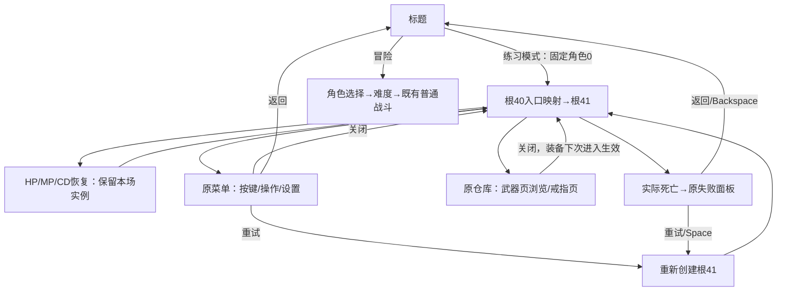

# LEBA-ACT-02 交付与验收

2026-11-15。本轮已接入原训练场、角色0默认动作/技能及共用战斗显示。**代码、自动回归和列明的原作受控样本已验证；完整人手连续操作、原生 Adobe Flash 一致性仍未验收。** 不表示全游戏、全职业、全装备或剧情还原完成。

**同日用户实测补充（当前阶段判断）：** 用户已亲自试用，确认当前版本能稳定游玩、角色0技能均可正常释放。用户同时指出音效丢失、击飞/伤害表现与原游戏不符和操作手感僵硬，明确将这些列为后期人工打磨。下文工具侧灰/黑屏及未验证范围保留为当次记录，不再据此阻塞角色1及全流程骨架恢复。当前可玩性确认不等于所有原作表现已精准还原；下一阶段按[ACT-03](../工单/LEBA-ACT-03_角色1与流程骨架_Godot原生编辑接入.md)接入原生编辑工作流与角色1。

## 1. 启动与当前可用范围

使用已有 Godot **4.6.3 mono stable / 7d41c59c4**。工程使用 GDScript，无需编译 C#。在 `godot/` 运行：

```powershell
$projectPath = (Resolve-Path .).Path
$godotPath = Join-Path (Split-Path $projectPath) 'tools/Godot_v4.6.3-stable_mono_win64/Godot_v4.6.3-stable_mono_win64_console.exe'
& $godotPath --headless --audio-driver Dummy --path $projectPath --editor --import --quit
& $godotPath --path $projectPath --audio-driver Dummy --rendering-method gl_compatibility -- --mute-audio
```

标题点击“练习模式·角色0”，进入根41；不是 action-lab。原入口2027/3016→40→41映射到此正式入口，根40加载过渡页没有另做一个可停留场景。快速入口为追加 `--training`；动作诊断仍可用 `--action-lab`。

测试及窗口检查全部静音。`--mute-audio`不改档案音量，Dummy不向设备输出；正常声音播放需去掉这两个参数。正常工程音量仍按自己的档案设置读取。

本轮范围：训练根41和原有根2/4/6；角色0默认形态。角色1原有移动、X首段、S及受击保留回归，其他技能未因此完成；角色2～5、所有装备分支及全剧情继续暂缓。独立窗口的灰/黑屏在最终复测仍有间歇复现，下面命令不是“稳定启动已验收”的承诺，详见第5节。

## 2. 流程与状态归属



原菜单及仓库不冻结战斗。Esc和失焦暂停是单独的工程操作，不能称作原作菜单暂停规则。未实现的分类、画质等控件禁用并有说明。

| 归属 | 内容 |
| --- | --- |
| Profile / SaveStore | 金币、无色、选择、装备/持有、通关记录、音量、自动保存设置 |
| Session.run | 当前场景、难度、场内计数、用时、一次性结果 |
| Battle / Combatant | HP/MP、动作/身体、源时钟、弹、榴弹库存、C4、弹种、召唤、冻结/感电/眩晕、标记及毫秒任务 |
| SourceHUD / SourceMenu | 只读快照和显示缓存；按钮发意图，由 Main/Battle/Progression修改真实状态 |

仍是原有 Main/Battle/Combatant/SourceClock/SourceSprite 一条执行链。没有第二套训练 Runtime、全量 Flash 解释器或平行伤害系统。25Hz负责源动作/事件；显示、Godot物理回调和Z的10ms/500ms任务保持不同时间尺度。

## 3. 训练实例与共用机制

- 地图8483、地面4393、玩家6732、训练4030、HUD和按钮分别运行，未使用含静态演员/999占位的整张41.png。
- 玩家根坐标132.4/314.9，scale .6369171/.65245056；敌412.1/361，scale .52941895/.51246643。地面原矩形、注册点、透明度及根深度保留。初次HP/MP/max为130；原HP+10戒指使HP/max为140，装备变化在重入时生效。
- 训练敌HP/max为有限的1e22；严格距离±100之外才移动2，但只要原移动区相交，另一个独立监听仍使动作回2。没有普通近距追打入口。受击观察器为2，没有混入Expert额外1。
- 恢复按钮仅赋HP/MP200并送技能栏7，后续再封顶并按许可状态初始化；动作中恢复保留等待。它不清演员、坐标、C4、榴弹库存、弹种或召唤。Y有自己的533帧等待。
- 训练敌被测试夹具强制致死时没有普通奖励、胜利、推进或臆造补刷。玩家可死亡并重试。训练不等于禁止保存：保存持久字段，当前HP/MP/动作/敌人不入档。
- Z坐标先恢复源twips再加3/截断，覆盖494.9及反向连续任务。结束后正常更新/F6都走相同的死亡尾帧和声音分派，不重复结算。
- 空中正常代理与可见公中层分开。既存3889再次seek2、初次创建marker1、pose2移除及回pose1新建不是同一操作；空8实例保留，不能以图像不可见判断不存在。
- 新建helper只Load，下一tick才EnterFrame。Y/子弹回调按实际创建顺序逆序处理；helper空3仍可能有全局观察器。保留3889源8的stop队列与同tick重新seek2造成的停2行为，没有补“更合理”的统一命中间隔。
- 原`y += g + gacc`按`y + (g + gacc)`计算，再截断到twips；不是加epsilon修图。地面检测、落地当tick恢复移动及边界限制的阶段经过原样本校准。

原作训练“MP无限制”文字没有实现为永久无限MP：实际按130初值、源消耗、每tick .05回蓝与恢复按钮运行。1e22的双精度生命也会丢失很小扣血；伤害对照使用明确HP2000夹具，未换成绝对无敌。

### 默认操作覆盖

| 输入 | 本轮运行行为 | 默认消耗/时钟要点 |
| --- | --- | --- |
| ←/→、X、C、空中X、↓ | 移动/转向、六段连击、跳跃与独立空中射击、后撤、受击/落地/死亡 | 复用并回归M1；不添加预输入/Hitstop/新取消 |
| Z / A | Z双入口；A源113的21起分支，独立1108跑动/接触/超时爆炸 | Z3MP，A7MP；共用66帧槽，移动Z监听另核 |
| S / D | 原父11/13动作、弹/技能物理与标记观察 | S3MP/80帧槽；D5MP/126帧槽，不能把75写成统一总伤害 |
| W | 源113从1起，按方向生成613/603地雷、等待及爆炸/眩晕 | 7MP，270帧槽；与A不共用召唤行为 |
| F / G / H | 先装填，再由独立HUD投掷；飞行接触选择爆点，分别物理/感电/冻结 | 各装填5MP；库存5/4/3；投尽才开始217/270/324帧槽，投掷图标独立81帧 |
| Q、↑/↓ | 选择火/银，101等待自动选火；两355帧计时可并存 | 8MP，300帧槽；源9才激活，银覆盖火的外观但不取消火行为 |
| T，再按T/方向 | 独立6813/准心/六发弹药/弹壳/265计时；源13窗口检查弹药7退出 | 15MP＋无色2，801帧槽；单发40观察与眩晕/3945分开 |
| E / 按住E | 三次放置计数及附着，第三次后引爆；有附着时可在12按住提前引爆 | 放置仍需MP≥7但扣0；引爆7MP＋无色1，360帧槽 |
| R | 本体、根位移、独立1513火地板、29tick子循环及九个火花 | 12MP＋无色1，660帧槽；不把火地板当角色贴图尾帧 |
| Y，再按Y | 初始等待533，四个独立单位；行走/正常/集中，292/81计时及9帧退出 | 30MP＋无色5；激活停槽2，结束后才重启；集中38等待结束 |
| V | 源6抓取/空抓、锚点公式、分组651、松手与返回后的命中尾段 | 5MP，218帧槽；成功与失败不共用线性动画 |

Shift/5、B、Ctrl/6、Space觉醒等条件槽不是默认开放，本轮未强行解锁。装备85/1/25穿透率等变体不推广为默认值。默认弹头按3833的55阈值，普通体两个独立随机判断、冻结体一个；记录Godot随机种子，不承诺与Flash随机流相同。

角色/技能详细原文件、帧范围和分支见[技能依据](LEBA-ACT-02_技能依据.md)。

## 4. 资源、显示与音频

仓库外`../res/`是完整提取库，工程`res://`指本目录，二者不同。原SWF、原AS/XML/字节码、工具、完整图库仍在仓库外，只读。当前catalog登记**4542个来源、257个输出、2465个动画帧**，包含沿用资源；不是全库导入。

[asset_catalog.json](../data/asset_catalog.json)保留ID、路径、帧号、裁剪union/逐帧pivot、矩阵、颜色/滤镜、音频事件及输入输出哈希。SourceSprite已应用烘入的立即父偏移/缩放，祖先矩阵另算；不能在运行时再乘一次。

```powershell
# 只核验，不派生
python tools/import_runtime_assets.py --verify
# 必要时只更新已核键；其余资源和输出保留
python tools/import_runtime_assets.py --act02-animations crt0_skill_q
python tools/import_runtime_assets.py --act02-geometry
```

训练标题8491单独保留原Glow/阴影/Bevel；地图原色变换、地面15/256透明度已烘入。冻结外时钟/身体反应、C4三枚/闪光/爆炸、Y十二个循环、T准心/计时独立。HUD数字、HP/MP、无色、库存、冷却与命中Combo来自实际状态，敌血条使用原素材。

普通根2/4/6与训练分别登记玩家/敌/地面、Y根、狙击、技能栏/HP/MP/HUD深度。4393四场矩阵/透明度完全一致，复用小图。原Combo4679跨根帧保留；Godot范围之外的显示深度保持相对层级映射；相同z上按原深度排序，低层替换对象不会因晚创建而盖过高层存活对象，原碎屏也保持在后来生成的A之上。未实现通用Flash显示树。

音效按源事件和in-point/已有AudioDirector播放；本轮PCM/循环测试包含训练`gate.mp3`。动态Combo数字使用原字体/颜色和轮廓，但Godot动态字体的Bevel/Glow与Flash滤镜仍非逐像素一致。

`_root.닐스나이핑`两处原调用未找到同名根实例/导出链接/创建代码，已登记具体来源缺口，未凭空连接HUD同名槽。可见的6813、准心、弹药、计时、原728碎屏及6835切入已接入。

## 5. 原作对照与最终回归

环境：Godot4.6.3、Windows、Dummy音频；GL实测为NVIDIA RTX5070Ti / OpenGL3.3。原作受控运行使用已有Ruffle0.7.1、commit `89a7049965f3090e706265670df309a5128233ac`。派生观察SWF只新增观察/夹具DoAction，原SWF未重写；每项干预和原日志另存。

原样本包含：默认初始化/恢复、A接触和150超时、W接触、Q计时、R/C4、H94/冻结弹/银弹/T单发、V成功/空抓，以及Y正常自然结束和移动→停止→集中。原生Flash未运行；Ruffle结果不冒充Adobe结果。各源样本用有限HP2000、位置/动作seek等明确夹具，不能称自然键盘游玩。

**Y长样本最终严格比较661行场景、1996行子动画、163行helper、1367行子弹，包含HP/XY/g/gacc/标记/宿主/生命周期，差异为0。** 正常和集中两次样本扣血1175/295只适用于本夹具。原raw serial会复用同名路径，实例重建改用host/depth/实际源1出生代，未把原日志改写成正确答案。

### 自动化结果

命令：`python tools/run_act02_checks.py --name <新目录名>`。顺序运行，独立档案，真实Main/输入派发/Battle；不会覆写旧证据目录。最终合计**16套、1249项通过**。重复复跑不累计成新通过数。

| 套件 | 项数 | 最终范围 |
| --- | ---: | --- |
| actions / m1_actions | 129 / 166 | 基础/六段/空中/后撤/Z/时钟与结束尾帧 |
| hit_timeline / gameplay | 78 / 102 | 标记、普通关卡/失败/推进/角色1/完整档案 |
| services / progression | 113 / 28 | JSON保存/备份/异常、原PCM/循环/静音、既有戒指 |
| act02_training / skills | 58 / 198 | 训练实例、恢复隔离；A/W/Q/库存/分支/R/C4逐帧；另有明确静态来源的冻体解除与跨Godot上限的显示深度用例 |
| act02_status / v / t | 33 / 28 / 44 | H/冻结/银，V逐帧，T原单发及静态六发/边界/时钟 |
| act02_y / y_source | 62 / 34 | 真Y键门槛/十二循环；上述全长原轨迹 |
| act02_ammo | 56 | 真Q→X、双标记、731持帧、55阈值及多目标 |
| act02_menu / integration | 87 / 33 | 原素材控件/命中区、正常Main鼠标整链/真实隔离盘存档、失败页移除榴弹显示 |

`final01`的唯一玩法测试失败是旧“每发必穿两敌”假设；原55判定使此条件不成立。用明确seed265允许两次穿透后在`final02/03`验证同一多目标伤害链，另有ammo的停弹/55边界检查，没有关闭随机或放宽伤害。旧M1“下落后标记永不存在”、Y三处即时控制阶段假设，也按新原证据纠正，失败记录均保留。

来源与最终汇总：`artifacts/leba_act02_20261115/final_validation.json`、`final01/summary.json`及必要针对性复跑`final02～06`。最后的源深度、C4冻体支线及失败页显示各自有对应回归；不把较早版本的hash称为最后版本。服务套7条WARNING均为刻意非法输入用例；其余最终套无ERROR/非预期WARNING。记录读取实际退出码，不只看引擎是否返回0。

### GPU与Windows窗口

- 最终`final_render02`的GL输出13张，覆盖标题、训练、空中X、恢复、仓库、设置、R/T/Y、根2/4/6及角色1。`final_render02/stdout.log`及`stderr.log`记录退出0，无ERROR/WARNING；已实际查看训练/T/Y、普通场景及角色1画面，不把headless空图算GPU验收。
- Windows真实窗口已用OS鼠标/按键进入正常训练入口，观察X/D/T、恢复、菜单、设置和仓库并正常关闭。`native_flow02`保留实际INPUT、动作/命中轨迹与空stderr；该窗口检查发生于最后共用机制校准前，最终版本另经自动/GPU回归。
- 初次相对路径后台启动只见灰屏；明确绝对路径的一次启动曾可玩，但最终相同路径重试又出现灰/黑。已有编辑器的窗口捕获也显示黑色客户区，故不能证明只由项目初始化造成；引擎、驱动或捕获环节尚未定位。延后加载同一Main的备用入口未改善，已撤回新增的入口，不绕开验证或改造主架构。
- `native_final/native_bootstrap`保留未通过的启动日志。只停止核过路径和启动时间的自建进程；用户原有编辑器保留并恢复最小化。**冻结版本的最终OS窗口验收受阻**，没有用早期成功或13张GL图替代。详细强制`--quit-after`启动曾留下MP3引用警告；正常`stop_and_drain`及早期窗口关闭另有验证。不据此重装或删除用户环境。
- OS工具仅提供短按/组合键，没有持续按住/松开接口。**人手长按移动＋空中X、连续六段、移动/受击Z与D取消未完成最终Windows人工验收。** 自动合成输入已测，不与人手输入混淆。

## 6. 存档与保护结果

仍是Godot schema1 JSON。新增`progress.clear_cubes`默认200；settings增加`auto_save/auto_quality`布尔字段，旧档缺失时增补false，既有65%音量保留，新档按原80%。默认自动保存关闭；开启时按10源tick检查持久字段变化，避免相同档反复替换。旧无色值不在进入训练时补满。

正常档案为`user://profile.json`，临时/备份/无效档处理沿用SaveStore。测试使用独立`user://`路径，不覆盖正式档。原Flash133槽的金币41、无色43、自动保存47、自动画质85等已调查，但**未做SharedObject导入/导出或兼容承诺**；未知装备/解锁字段不能凭Godot JSON推定为Flash兼容。

全量重新读哈希：**191733文件、2982789466字节**，原SWF SHA256 `afef4c43153780e9140eca7234b5af26c4a751596efefeb071d35428435a909d`不变；catalog4542来源/257输出通过。`source_integrity_final01.json`是本轮新报告，旧报告未覆盖。

开始时main/HEAD为`556d40fc6ae8e02766af9f7c9cbde93f51db9b96`，README已有修改、主体多为未跟踪文件；没有reset/提交/推送。197个已有文件的baseline.zip保留，最终缺失0；完整原资源未改。新增Godot导入缓存不算原始资源修改。

## 7. 主要修改与扩展入口

| 文件 | 职责 |
| --- | --- |
| `scripts/main.gd` | 正式训练入口、原菜单/仓库/失败、设置/保存、隔离验收参数 |
| `scripts/core/content_db.gd` | 原场景/默认动作、源事件及各根深度注册，必要资源缺失时报错 |
| `scripts/combat/battle.gd` | 同一源时钟/输入/物理/标记链，具体技能/持久子实例、创建序回调、状态清理 |
| `scripts/combat/combatant.gd` | 动作hold/seek、独立子时钟、冻体/受击/死亡/源注册点/敌血条 |
| `scripts/ui/source_hud.gd`、`source_menu.gd` | 原HUD、动态读数/冷却/反馈；源菜单和原命中区 |
| `scripts/ui/game_ui.gd` | 原组件挂接及现有流程视图 |
| `scripts/core/progression.gd`、`services/save_store.gd` | 增补字段与真实盘存档，不复制战斗数值 |
| `tools/import_runtime_assets.py`、`data/asset_catalog.json` | 最小资源派生/矩阵/来源和验证 |
| `tests/test_act02_*.gd`、`tools/run_act02_checks.py` | 各行为及独立原轨迹回归、实际退出/日志/运行前后hash |

后续动作以ContentDB的父/子序列、事件、资源和允许状态接入；独立子实例进入既有Battle生命周期与回调，不复制Main/输入/伤害流程。场景通过stage实例规则与源矩阵/深度接入。不要把本轮具体伤害、速度或C4/Y顺序套给其他职业。

## 8. 验收步骤与剩余边界

1. 从标题进入训练；确认130、无色实际库存、训练敌、源HUD。走动/转向，试X六段、C＋按住X、↓、Z/S/D。
2. A/W各自召唤；F/G/H先装填再投，观察库存与独立图标；Q后↑/↓并X；T后方向瞄准/多次T及等待退出。
3. E三次并引爆、按住提前引爆、空放计数；R持续火地板；等Y亮后Y及再按Y集中；V近距抓取与远距空抓。资源不足时不扣资源、不伪造成功。
4. 动作中反复点HP/MP/CD，确认位置/库存/持续对象保留；仓库与设置可关闭，戒指重入生效。原菜单“操作”可重试/返回，失败可点击或Space/Backspace。
5. 返回/重进，核对瞬时对象清理、130与库存重新初始化、持久无色不补满、原普通根2/4/6及角色1不受训练参数污染。正常关闭窗口无遗留测试BGM。

| 事项 | 当前结论 |
| --- | --- |
| 第3.1/3.2：入口/训练/恢复/必要菜单仓库 | 已接通，自动及部分OS窗口通过；完整人手持续操作待验 |
| 第3.3：默认CRT0集合 | 全部列明默认入口及依赖已接；自动、具体原作样本通过，特殊装备未展开 |
| 第3.4：共用画面/HUD/声音 | 原最小资源和数据已接，13张GL及Dummy PCM验证；动态字体滤镜仍有差异 |
| 第3.5：M1两审阅问题 | 修复及针对性回归；M1人手长按/多键收尾仍未验 |
| 原生Adobe Flash、所有随机种子/多目标/冻结交叉组合 | 未完成穷举或原生对照，不宣称一致 |

**还需继续逆向/运行确认：**原生Flash与Ruffle队列差异；T缺失的根覆盖实例；所有难度/多目标/冻结/死亡/同帧中断的组合样本；所有装备、条件槽、完整存档槽兼容。已测单发T80、H94支线45、V195和Y两组伤害不能提升为通用常量。

**规则已明确但本轮未展开：**非默认装备85/1/25等参数和技能分支；完整仓库武器/饰品材料/兑换；其余角色/商店/剧情内容；Flash画质没有Godot等价实现。**环境/验收阻塞：**最终OS窗口灰/黑屏原因未定位；人手长按/多键、窗口缩放与长时间持续训练未整体完成，不以1249通过数替代。
