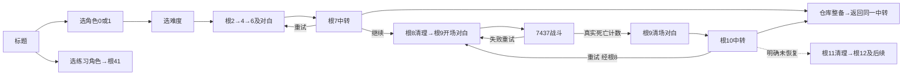

# LEBA-ACT-03：交付与原生编辑指南

日期：2026-11-16。范围为本轮角色1默认集合、原生内容编辑链，以及根7之后推进至根10。全游戏、全装备、全部旧内容编辑化和原生Flash精确一致性均未完成。最终回归结果见本文末段及对应证据目录；早期失败日志保留。

2026-11-17用户验收补记：**本阶段验收通过，第二个角色（内部`crt_1`）各技能可正常释放**。用户同时确认其音效基本未接入、Q特效引用错误；这两项尚未修复，已纳入[ACT-04](../工单/LEBA-ACT-04_角色2接入与基础音效特效验收.md)，随第三个角色`crt_2`接入补修。本报告原工程测试结果保留，不代表全部默认技能音效与可见特效均已正确；此前静音/流解码及部分独立时钟测试不能代替逐技能接线与画面检查。基础声音接通、特效引用正确纳入当期恢复要求，精细混音、精确时机和手感仍留后期。下文为原交付记录，未因本补记重新执行测试。

## 1. 可玩的内容与启动

用工作区 `../tools/Godot_v4.6.3-stable_mono_win64/` 内Godot **4.6.3 mono / 7d41c59c4** 打开本目录 `project.godot`，F5启动 `scenes/main.tscn`。工程使用GDScript，无需C#编译。标题“练习模式”现在先选角色0或1；“开始冒险”保持选角色→难度→前段关卡。未恢复的角色和模式明确禁用。

角色1可用：移动/转向、五段X、C/独立空中X、Down、默认Z/移动Z/受击Z，以及A/S/D/F/Q/G/H/W/E/R/T/V。D包含近身与空挥、后续Z及空中射击；H含四方向和有限连续段；W含20发、移动、翻向和C退出；Q独立持续；R含接回再投的三段；T含开局等待、三保持段、击杀分支与死亡释放；V按本角色锚点抓取。**T使用T键，Y仍仅角色0。** 非默认的4151/4155/4165/4172装备/解锁分支未开放。实际源ID、默认条件和消耗见[角色1依据表](LEBA-ACT-03_角色1与资源依据.md)。

基础键：←/→、X、C、空中按住X、↓、Z/A/S/D/F/G/H/Q/W/E/R/T/V。持续/方向动作需按住对应键；新按键不等于每个技能在任何状态都许可。训练原静态说明图仍为8490原图，其“Y”等文字不代表角色1新增了Y技能；选人说明和HUD以当前角色真实槽为准。HP/MP/CD按钮沿原训练恢复规则，不清敌。

测试或不希望声音时，从工程目录使用：

```powershell
$godot = '../tools/Godot_v4.6.3-stable_mono_win64/Godot_v4.6.3-stable_mono_win64_console.exe'
& $godot --headless --audio-driver Dummy --path . --editor --import --quit
& $godot --path . --audio-driver Dummy --rendering-method gl_compatibility -- --mute-audio
```

本轮自动/编辑器试跑均为Dummy音频、独立测试档，不改正式音量。`--test-mode --test-profile=user://.../profile.json`用于隔离档案；`--training`快捷进入角色0训练，角色1用正常选人入口。原动作实验入口继续保留，不能把它当正式流程或保存结果。

## 2. 流程边界和模块职责



根9使用自己的7370地图、7437敌人11动作、攻击/击倒/计时几何和对白，未将7176改名。基础HP500再按三难度得到500/750/1000；金币300/350/400，死亡唯一计数。根7和10可整备、重试、返回；角色页按2+crt，装备沿同一Progression服务，在下一场初始化生效。根9真实伤害击杀、奖励与推进均有独立回归。

根10继续按钮说明根11→12尚未恢复，**根10不是结局**。根12以后到普通结算71、真结局相关96/97，以及塔/隐藏分支的逐节点来源与缺口，见[流程依据§7](LEBA-ACT-03_流程依据.md#7-到原结算之前的全部根节点及缺口图)。真结局进入96的部分连线仍待追踪，不能按编号补出剧情。

仍为一套执行链：Main负责入口/跨场景流程和档案；ContentDB适配作者资源为既有Dictionary；Battle负责单场输入、25Hz事件、共用判定/伤害/独立对象及清理；Combatant负责每演员HP/MP/动作和身体；GameSession/Progression负责单局进度、唯一结算及装备；GameUI读取状态；AudioService/SaveStore沿用。没有第二套角色1Runtime或伤害系统。显示/物理更新与25Hz源时钟分离，Z的毫秒任务另计。

## 3. 内容放在哪里，哪一份生效

|内容|现在的权威入口|实际消费方式|
|---|---|---|
|关卡/训练摆放|`scenes/stages/root_{2,4,6,9,41}.tscn`|实际Map/SourceGround、PlayerSpawn/EnemySpawns、Bounds和Floor/Collision；不再被catalog坐标覆盖|
|场景规则|`content/stages/*.tres`|敌类型/基础HP、训练值、音乐、下一场及extra难度奖励/对白；位置以场景节点为准|
|演员模板|`scenes/actors/{combatant,crt1,enemy}.tscn`|实际Visual、AuthorOffset和ActionPreview；同Combatant脚本；按选角选择模板|
|角色1与7437动作|`content/characters/crt_1.tres`、`content/enemies/goblin_7437.tres`及动作目录|34个角色1动作、11个敌动作，每项含帧序列/事件/HitWindow/输入及状态、消耗/冷却等|
|角色1独立组件|`content/components/crt1/*.tres`|jump/d_follow/moving_fire/awakening/buff/gunhawks/grab共7个Resource；parameters保存子时钟、位置、判定和阶段参数，运行读作者值|
|角色0已迁移动作|`content/actions/crt0/{idle,basic,skill_s,knockdown}.tres`|其余旧复杂内容仍沿已有定义，不声称全部可编辑|
|HUD/菜单/仓库|`scenes/ui/source_hud.tscn`、`source_menu.tscn`、`game_ui.tscn`及默认Theme|真实静态布局/按钮；运行只更新帧、填充、数字、可见性和动态宿主，不删除整页|
|统一注册|`content/index.tres`|角色、敌、关卡PackedScene、共用演员及flow引用|
|对白/中转路由|`content/flow.tres`|本轮首次由`data/act03_flow.json`转换，此后作者Resource生效；源JSON只作依据|
|生成素材|`assets/`、`generated/animations/`、`data/asset_catalog.json`|仅按需导入；动画Resource引用真实Texture2D和原pivot/region；不保存HP或冷却|

舞台逻辑原点保持550×400；不要用Stage根节点的整体旋转/移动来替代内部布局。位置用出生Marker、Map和HUD布局节点调整；地面使用RectangleShape2D。EnemySpawns父变换、各出生点位置/尺度由适配器读取。演员AuthorOffset将手工偏移与动作源位移分层；更换职业模板时公共出生点仍生效，各职业外观偏移在各自演员模板编辑。场景子Actor的实例覆盖只针对该模板，不能假定会复制给另一职业。

主场景World与Interface为明确宿主；只打开关卡/演员场景不会运行Main、战斗或存档。F6关卡通过StageLayout进入同一Main/Battle。`preview_character`只决定该场景F6的角色；外观预览通过相应演员模板选择动作。单独F6演员模板仅用于看模板，不是完整关卡入口。

## 4. 不改脚本的编辑操作

### 出生、场景和UI

1. 打开`scenes/stages/root_41.tscn`，在2D树选择`PlayerSpawn`或`EnemySpawns/Enemy0`，拖动或改Inspector Transform。角色及敌人是实际模板实例。地图与地面分别编辑Map/SourceGround；边界Marker和Floor/Collision会参与正式运行。
2. 移动该场景`HUD`可整体调整；展开实例的“可编辑子节点”后改Characters下Layout，或打开`scenes/ui/source_hud.tscn`统一修改模板。实例已有的源层级覆盖会优先于模板；用Inspector属性旁的回退箭头恢复继承。不要把HP填充子节点的实时scale当布局参数。
3. 菜单/选人/中转在`game_ui.tscn`的Pages；原菜单/仓库在`source_menu.tscn`的Pages。调整真实Button的位置、尺寸、字体/Theme和锚点，按钮命中区随Control改变。背景装饰Sprite不是按钮命中区。
4. Ctrl+S，关闭重开场景，再F5进入对应入口。F6直接运行场景；编辑其`preview_character`为crt_1可直入角色1。场景的HUD实例位置不被Main的世界抖动覆盖。

### 动作、判定、音效与预览

1. 例如打开`content/actions/crt0/skill_s.tres`或`content/actions/crt1/skill_a.tres`。Input and resources分组编辑input_id、allowed_states、cost/required_mp、cubes和cooldown_ticks；Clock分组编辑源帧sequence、衔接窗口和下一动作。原作父帧门禁等位于extra的source_allowed_parent_frames，取消/多阶段条件位于extra或组件参数；只改allowed_states不会自动移除这些额外门禁。
2. Events项展开真正的ActionEvent：frame是**25 FPS源帧**，kind选择已有事件类型，AudioStream可直接拖入音效引用，audio_offset为秒；投射物/位置/gravity/damage等按事件类型生效。不是每个事件都消费所有字段。不要仅改旧parameters里同名值：有显式字段时显式字段优先。
3. Windows项展开HitWindow，改from/until及Rect2数组；正宽高矩形才可命中。kind决定使用普通伤害或原作marker链；Damage只表示该窗口自身贡献，不能假定是含公共观察器的总伤害。override_hurt_rect开启后可直接编辑该动作身体。visual_offset只改视觉，不自动改攻击矩形；演员AuthorOffset会同时作用于已适配身体/攻击。
4. 角色1复杂持续对象在动作引用的component_definition→parameters：W的移动速度/发射帧/弹数/重力和observer奖励；T的holds、计时、phase_helpers矩形/重力/bonus、cutin和死亡释放帧；R的子/根timeline、接取/连投参数；V的接触、抓取锚点、marker和结束规则。字典/数组在Godot Inspector展开即可编辑，不是运行时重新从catalog覆盖。算法仍在共用Battle，改不存在的任意key不会创造新算法。
5. 打开相应演员场景，选择`AuthorOffset/ActionPreview`，从文件系统把**正式Action .tres**拖到Action属性。Source Frame可输入/拖动；“源帧单步”“回到动作首帧”和Play可检查时钟。青框为身体，红框为当前攻击，黄标为pivot/位移，橙点为事件位置。T保持段与V组件矩形同样读取作者值。预览不打怪、不播音、不保存进度、不把状态写回定义。
6. 修改动作资源后用Inspector资源保存按钮保存`.tres`；Ctrl+S保存场景。关闭重开/重新启动后使用正式输入验证。预览的动作/帧选择可随场景保存，但不替代修改动作Resource。Remote页里的HP/冷却等属于这次运行，停止即丢；不支持全状态热重载，修改内容后重启。

后续新增动作：复制作者Action、设**新的identifier**、选动画并配置帧/事件/窗口，加入角色actions；新输入可先在Project Settings→Input Map增加按键，再把该名称填input_id。沿用输入名的连段仍由combo_next/窗口衔接，不把basic5当起手。复制场景需给Stage规则一个新identifier，加入`content/index.tres.stage_scenes`；Stage.next_stage/flow路由再指向新ID。编辑器索引直接消费，不再回ContentDB复制注册常量。重复或空定义/动作/场景ID会给出启动错误。

恢复默认值：未保存先撤销/重做；保存后优先从自己的版本控制或备份恢复指定文件。Godot回退箭头恢复脚本/继承默认，不等于自动找回原SWF值。首次转换脚本拒绝覆盖已有文件；本轮初始备份`artifacts/leba_act03_20261116/baseline.zip`只含开工时已有工程（**不含新作者文件的原始默认**），新内容应自行保存版本。不提供会静默重置全工程的“恢复默认”。

## 5. 资源追溯、再导入和档案

原SWF、全部提取的AS/XML/图片/音频、完整帧库和工具仍在Godot仓库外。磁盘`../res/`是完整提取目录，**不是Godot的res://**；后者指本工程根。`asset_catalog.json`的sources/outputs记录原ID、路径、选帧、源矩阵/pivot、处理方法与SHA256。此次共359个输出、3821选帧、8723来源哈希，保留ACT02原257个输出。

按需刷新流程：`python tools/import_runtime_assets.py --act03-animations <已登记key...>`，然后显式运行`tools/sync_generated_animations.gd -- --sync-generated`更新**已有generated动画元数据**，最后Godot导入。几何/场景素材用导入器对应窄选项；先`--help`确认，不运行无关全量导入。同步工具只写generated，保留UID，已有一致项不重写，写入失败回滚；不会更新content、scenes或游戏运行状态。[同步用法](../tools/sync_generated_animations.md)。需要人工改图集region/pivot时，将生成动画Resource复制到content目录并让动作引用作者副本；不能一边手调generated一边要求再次生成保留它。

`bootstrap_act03`、`convert_act03_crt1`、`bootstrap_act03_level`是显式首次转换；重复执行不覆盖已存在作者值。`register_act03`是显式补注册，普通启动/import不执行。一次性旧场景层级纠正带迁移标记，不在运行时回套原坐标。生成资料是依据，已迁移作者字段只有一处权威。

原6089音效尾部有非MPEG数据，Godot无法有效导入；仅运行副本改为44100Hz双声道PCM WAV，10368样本与DefineSound相同，转换方法登记在catalog。原MP3未动。

Godot档案沿schema_version=1，含settings、selection、progress、inventory/unlocks/equipment等规范化字段，安全写入/备份/坏档恢复沿现有SaveStore。HP、冷却、抓取、子时钟和当前对白不写共享`.tres`。原133槽已知金币41、无色43、戒指28/35～38、自动存档47、难度解锁4等继续记录在系统依据；没有证明Flash SharedObject兼容，不读取/覆盖原档，也不承诺断点恢复到根9当前战斗。奖励/菜单/交易/退出保存是现有Godot适配，不冒称各原跳转都调用saveGame。

## 6. 本轮修复与仍未迁移的内容

除角色1/根9接入，还修复：训练选角及仓库角色页、原生布局不被覆写、静态页面不再被清空、仓库/菜单失焦时暂停归属、全局输入新增动作注册、连段后段错误抢起手、T空身体被当点命中、T击杀实例死亡锁与111释放、R持续接取窗口、CRT0/1真实击倒、射击marker1～4和子动画音效、派生动画同步UID保护。T的锁按实例保存，离场不会把锁写进共享定义。最后清除了没有执行器支持的通用effect_scene/status导出字段，避免Inspector呈现可填但不生效的入口；具体原作效果仍按既有事件类型及组件配置。

尚沿旧路径：角色0其余复杂技能/子实例、旧公共marker/status/投射物的部分几何和回调算法、未触及的关卡/装备/模式。角色1外层动作、窗口、独立组件主要参数与新敌/场景均迁入作者资源；这不等于每个临时对象都已做成独立PackedScene，也不等于Flash任意算法都能通过填写字典新增。动作预览显示身体、当前直接窗口及T/V组件；世界级R弹体在关卡运行观察，不冒称预览播放完整世界交互。

后续分开处理：

|类别|后续工作|
|---|---|
|继续逆向/运行对照|默认Z与移动Z同keydown回调优先级、10ms定时器调度、marker/shot同tick观察器总HP、相同源页goto重建顺序、真实结局部分入口、随机装备掉落与完整获得条件|
|已有依据但未实现|根11/12起后续敌/地图/波次/对白、其后中转和结算；更多角色、非默认装备分支、全商店/装备、旧角色0复杂内容逐项原生迁移|
|后期人工打磨|用户反馈角色0音效缺失、击飞/伤害表现和僵硬手感；角色1各动作的音量、锚点/帧、位移、击退、观察器伤害与回调精校。没有用户具体复现样本的项目标“待样本”，不编造用户反馈细节|

## 7. 实际验证与证据

本轮验证在Godot4.6.3 mono、Windows、GL Compatibility / RTX5070Ti上进行。编辑器/自动运行静音；没有进行扬声器听验或新的CRT1/7437 Adobe Flash/Ruffle整段运行对照。原有CRT0 Y源结构对照独立回归，不扩大为整个游戏原版一致。

原生编辑器实际完成：移动训练PlayerSpawn **132.4→172.4**、HUD **+20x**，保存、关闭重开、F6确认；Inspector改S消耗**3→12**、CD **79→119**保存，正式S输入实得对应MP/CD；撤销/重做、保存和复位；角色1动作Resource拖入ActionPreview，单步到源5显示真实身体与攻击矩形；F5标题→训练选角色1、实际W开启/C取消/T演出、仓库、关闭窗口；F6训练场。测试结束恢复原布局和S参数，未把调试值留在交付内容。

证据在`artifacts/leba_act03_20261116/editor/`：`f6_reopened_spawn_hud.png`、`inspector_s_cost_cd.png`、`inspector_runtime.json`、`inspector_undo.png`、`inspector_redo.png`、`restored_defaults.png`、`crt1_a_frame5_preview.png`、`f5_crt1_t_actual_key.png`、`f5_crt1_warehouse.png`。原生操作抽查不等于完整人手游玩；短促工具按键不适合持续按住行为，按住射击/移动及全部连段由生产输入链自动回归补充。

自动编辑测试在隔离副本保存→深度重新加载→Main实际运行：改出生/地面/Map/HUD、S的帧3音效/帧4位移/帧6判定、7.25MP/19CD/23.5伤害，复制动作K的2MP/13CD/9.25伤害，真实SubViewport键盘与移位后按钮点击，多演员独立HP/CD。夹具数值仅为工程验证值。派生同步实际更新陈旧副本并保持UID，第二遍不重写，正式作者/素材/档案hash不变。此前UID失败和自动回滚记录保留。

角色1专项已209/209通过：默认输入、五段X、空中/Down、D/H/W/Q/R/T/V、拒绝条件、不同敌人受伤、独立音频实例、效果生命周期和重入。真实T输入的1HP接触夹具在源12致死，到97保持计数，111释放后只结算一次；空身体碰撞有正反回归。根9流程专项69项通过，两角色在完整500HP敌人上用合法输入击杀并到10，无改伤害/强制胜利；它不是原生Flash通关录像。

真实GL截图14张在`artifacts/leba_act03_20261116/render/`，已检查角色1HUD/W弹数/Q/T/射击marker/根9/仓库/中转构图。这里只对白/中转页的外观允许直接导航夹具，功能结算另由流程测试证明。全量原始资料重新读取SHA256：**191733文件、2,982,789,466字节**与原提取清单一致；原SWF SHA仍`afef4c43153780e9140eca7234b5af26c4a751596efefeb071d35428435a909d`。报告`source_integrity_final.json`，未改原提取库。

集中回归命令：

```powershell
python -B -X utf8 tools/run_act03_checks.py --name <新的证据目录名>
python -X utf8 tools/import_runtime_assets.py --verify
```

21套覆盖16旧套及CRT1/flow/ui/focus/editing；每套独立档、Dummy音频，记录本版源码/内容/素材冻结hash，保留退出码、错误、负例warning及前后hash。不以旧批次测试之和冒充当前冻结版本。此前final01的两个失败分别为旧测试对JSON双精度与Node2D单精度坐标作严格数组相等、以及测试把运行器正在写入的stdout.log误纳入作者资源哈希。前者改用仍核对原坐标的Vector2近似比较，后者改保护全部ResourceSaver实际输出；没有修改游戏数据来满足断言。final02通过后清理无效导出字段，再冻结运行得到以下最终结果。

**最终版本：`python -B -X utf8 tools/run_act03_checks.py --name final03`，21/21套、1754/1754项通过，所有退出码0，无ERROR/SCRIPT ERROR、无非预期WARNING。** Services的7条音频无效输入负例WARNING按具体种类保留并核对，不写成“日志无警告”。1754项由同一当前冻结版本得到，未累加旧批次。源码/内容/选中素材前后hash无变化，正式profile家族hash无变化；开始19:40:15、结束19:42:45（本地时间；精确UTC见JSON）。

|最终套件范围|检查数|结果|
|---|---:|---|
|16套既有角色0/输入/时钟/战斗/流程/存档/音频/UI及源Y对照|1335|通过|
|角色1默认功能/效果/音频/T锁/两角色击倒|209|通过|
|根7/8/9/10、两角色合法击杀、整备、失败和保存|69|通过|
|原生UI副本编辑/重载/实际移位点击|32|通过|
|失焦、暂停、双角色训练仓库及动态值|53|通过|
|动作/场景副本编辑与新动作、同步/UID/状态隔离|56|通过|

原始命令、运行版本、逐套退出码、全部错误/负例警告与源码冻结hash见[final03/summary.json](../artifacts/leba_act03_20261116/final03/summary.json)，前后清单为同目录before.json/after.json。实际编辑器图片、GL画面与原始资料全量校验是另外的证据，不能由1754项替代。测试后已关闭本Agent创建的游戏/编辑器窗口，未留下BGM播放。

## 8. 用户工作保护

开工为main/`556d40f`，README已有修改且工程主体多为未跟踪工作；未清理这些内容，未提交/推送/重置。开工快照`baseline.json/zip`记录121个已有工程文件，未删除其中任何文件；修改/新增清单在`modification_inventory.json`，原257输出逐项字节未变见`act02_assets_preserved.json`。所有必要修改在现有执行链增量完成。原资料只读，资源按需导入，旧工单/交付和早期失败证据均保留。原始素材完整性、正式档保护与作者资源不回写分别验证，不能用其中一项代替其他项。
