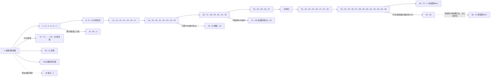

# LEBA-ACT-03：根7之后的流程与7437依据

日期：2026-11-16。此文为原 AS2 / XML 静态调查及本轮内容接入合同；不表示后续主线已经实现或经过原作动态通关。原素材只读。工单以用户当前指派为准，工单文件中“待指派”是编写时状态。

## 1. 当前实现与依据边界

核验时 Godot 分支为 `main`；README 已修改，工程主体仍是现有未跟踪工作，均保留。阅读了 ACT-03 工单、关卡/系统依据及 Main、GameSession、Progression。原作舞台550×400，25源帧/秒。以下帧号均为原时间轴帧号。

- `Main._next_stage` 只特别处理根7；`_dialogue_next` 只识别根2开场和根6结束。根9尚不能仅凭新建场景自动接通。
- Main 的仓库打开/翻页/装备目前只接受 `training_storage`；普通中转需要保存“从哪个中转页打开”的返回上下文，不能关闭后强行回战斗。
- `GameSession.begin_stage` 是单场初始化；`settle_enemy` 对唯一实例结算金币、剩余数，`finish` 对胜利计数防重。`profile.progress.clears` 是 Godot 记录，不是已证明的原133槽字段。
- `Progression` 已有持有标记与角色戒指槽，角色0/1共用这一服务。原仓库角色页为 `2+crt`，不能两角色都打开角色0页。
- 当前 `_start_training` 固定角色0，工单已要求按原3017入口增加角色1；本关卡分工不另写训练或角色Runtime。

历史关卡报告§6的7437 HP500是**难度处理前基值**。本次核对根9放置的6968后明确：默认三个难度分别500、750、1000；不是三个难度都500。旧报告中“墙精确形状待查”等历史状态以本节后续核验为准。

## 2. 根7→8→9→10的确定路由

| 起点 | 原事件与条件 | 结果 |
| --- | --- | --- |
| 根7 | `frame_7/DoAction.as` | stopAllSounds、stop、火地板回1；中转页，不是结局 |
| 根7重新挑战 | `DefineButton2_7199/on(release)` | 根 `gotoAndPlay(2)`，重新第一段 |
| 根7继续 | `DefineButton2_7341/on(release)`、`on(keyPress Space)` | 根 `gotoAndPlay(8)` |
| 根8 | `frame_8/DoAction.as` | stopAllSounds、火地板回1，没有stop，下一源帧自然根9 |
| 根9初始化 | `frame_9/DoAction.as` | stop；HP/HPM/MP/MPM100；清本场计时、抓取、弹种、C4、Y等状态；BGM/7130.mp3 |
| 根9开场 | `DefineSprite_7469/frame_1/DoAction.as` | 对话stop，玩家父17；点下一句，Space跳7；7的DoAction立即跳16 |
| 根9开战 | `7469/frame_16/DoAction.as` | 对话stop，玩家父1，由6732自身按crt选择角色表现 |
| 根9死亡计数 | 根实例7437 `_47`观察 `속.죽음`帧3 | `남은수.nextFrame()`，三个C4挂点回2 |
| 根9清场 | `frame_9/PlaceObject2_4413_1011/…enterFrame.as` | 计数器父2且子속2时，Dgun增加1，对话跳17 |
| 根9结束对话 | 7469帧17～21；Space17要求物品窗帧1，21的Space直接22 | 帧22 `_root.gotoAndStop(10)` |
| 根10 | `frame_10/DoAction.as` | stopAllSounds、火地板回1。该脚本本身没有stop，但入口 **gotoAndStop(10)** 已使根停住，不能自动前进 |
| 根10重新挑战 | `DefineButton2_7473/on(release)` | 根8→根9 |
| 根10继续 | `DefineButton2_7476/on(release)`、Space | 根11清理→根12；本轮若未接根12，明示后续未恢复，不能伪造胜利或结局 |
| 根7/10仓库 | `DefineButton2_7345/on(release)` | `_root.메인.인벤토리.gotoAndStop(2+crt)`；7346子2728为现有仓库 |

原根9开场只暂停玩家，代码对不存在的敌2～5调用stop，并未暂停首敌7437或独立计时器7440。将整个Battle暂停以显示Godot对话属于流程适配，不能描述为原作所有子时钟都停止。精确等待对话时的攻击/计时属于后续表现校准；无论采用哪种适配，都必须避免玩家在不可操作状态被静默结算失败。

### 2.1 失败、重试、返回与持久状态

- `frame_9/PlaceObject2_6917_2832`：失败面板3→根1；4→根8→9。原无复活第三分支，不自动接根72。
- `frame_9/PlaceObject2_6956_2877`：菜单4→stopAllSounds、根1、主菜单intro296；5→stopAllSounds、根8→9。
- 根9重入重新创建敌/玩家/计时器/判定对象，HP与MP按本场100基础加原装备，不保留战斗中受伤、标记、C4或本场计时。角色、难度、金币、库存和装备继续属于跨场景状态。
- 原7/10页面直接有“重新挑战/继续/仓库”；额外“返回标题/选角”可作为Godot导航，必须写清对应目标，不假称新增按钮是原页原按钮。
- `GameSession` 防重可以继续使用；不能把一场重试再次击杀视为同一死亡、也不能退回菜单时再次结算前一次奖励。

## 3. 根9布局与身体几何

以下位置为舞台像素，矩阵 `[sx,skewY,skewX,sy,tx,ty]`。XML所有原始平移为twips，除20得到像素。根9实际只放置一个7437，不能因脚本遍历敌2～5而凭空生成五敌。

| 实例 | ID / 深度 | 变换与用途 |
| --- | --- | --- |
| 地图맵 | 7370 / 3 | identity、位置(302.35,88.6)，f1 stop；静态初始页 |
| wall | 7131 / 1 | (268.9,211.65)；XML只有声音流头和ShowFrame，没有形状，不能将550舞台宽度虚构成此墙的碰撞 |
| 地面땅 | 4393 / 999 | (305.85,360.15)，独立地面判定 |
| 玩家일 | 6732 / 1014 | (92.9,315.9)，scale(.6369171,.65245056) |
| 敌적 | 7437 / 294 | (471.3,364.55)，scale1，默认朝左 |
| 敌计时器 | 7440 / 2079 | (288.45,613)，不可见不等于不运行 |
| 难度处理 | 6968 / 2918 | (436.35,81.2)，f1修改HP倍率 |
| 对话 | 7469 / 2922 | (278.5,336.55) |

根7和10三个按钮的舞台位置相同：重新挑战(236.2,256)、继续(279.1,295.1)、仓库(324.2,256)；仓库容器7346位置(202.4,45.3)，其子2728偏移(80.3,154.5)。按钮点击区来自按钮记录，不能用贴图裁剪边界代替。

### 3.1 身体、触发区和浮空

7437外层1放内层7427于(0,0)；外层2移除7427，放7436空中绘图于(-12.55,.5)、4029空中行为代理于(-4.35,-48.85)，代理scale(.74661255,.56915283)。外层两页均stop。

| 名称 | 源形状bounds(twips) | 内层7427放置矩阵（像素平移） |
| --- | --- | --- |
| 行动身体7157→7156 | [-813,-1179,813,1179] | [1,0,0,.6920471,-3.1,-39.95] |
| 移动7144→7143 | [-746,-754,745,754] | [6.061737,0,0,1.152771,-257.25,-42.6] |
| 远距7379→7378 | [-310,-600,310,20] | f1[1,0,0,1,-228.75,-17]；f2/3位置(-233.75,-18) |
| 近距7379 | 同上 | f1[2.9310303,0,0,5.137924,-125.9,24]；f2/3位置(-118.9,24) |
| 平打7379 | 同上 | f1[2.4396973,0,0,2.0905762,-15,-6.2]；f2/3位置(-11,-6.2) |
| 外层重力身体7429→7428 | [-889,-2237,888,30] | [1,0,0,1,-.8,-7.1] |
| 冻结身体7157 | 同7156 | inner149 [1,0,0,1,-1.1,-50.95]，不是正常hurt矩形 |

移动/近远/平打三个触发区只在inner1～3存在，4移除。特殊动作121移除行动身体，131才重新放置；121～130不应沿用普通地面受击框。空中代理另算，不能用渲染PNG bounds。normal空中代理4029的子1119初始矩阵与外层7437矩阵相乘，不能沿用4030或7176整套外偏移。

`frame_9/PlaceObject2_4393_999/…enterFrame.as`：敌重力身体与地面相交→g=1、gacc=0、敌y=地面_Y。因此 **出生y364.55不等于ground_y**；实际地面360.15。

根1常驻3829按pren0/1夹x到0..550，其他pren敌为-100..650；它与敌浮空位移存在宿主回调先后。ACT02已证明探针可在夹限前看到>550，不应“前后两次clamp”伪造更硬边界。此规则是独立常驻脚本，不是空wall7131。

## 4. 7437动作与战斗合同

主要来源统一记为 `res/scripts/frame_9/PlaceObject3_7437_294/CLIPACTIONRECORD onClipEvent(enterFrame)_N.as`（第一条无`_1`）；动作脚本为 `DefineSprite_7427/frame_N/DoAction.as`。角色身份由原文本7443确认“巨剑阿修罗”，工程identifier为稳定源ID `goblin_7437`，不据identifier含goblin推断种族。

### 4.1 动作路径与独立时钟

| 作者动作 | 原时序 | 要保留的行为 |
| --- | --- | --- |
| idle | 7427/1 stop | 7377初始绘图；重置原combo |
| move | 7427/2内7382，10帧独立动画；父2/3/4→1 | 绘图偏移(-6.75,24)；父控制与子循环分离 |
| attack | 6～29，29跳152，152～155→2 | 不能顺播30～40作为近攻尾段 |
| ranged | 41～100，100跳30，30～40→1 | 前半普通受击，后半击倒判定 |
| melee | 101～120→2 | 近身第三种触发，不是远攻别名 |
| special | 121～140→2 | 121～130无行动身体；131起判定 |
| hit | 141～148→2；粘附接触入口143 | 不能复用7176受击帧 |
| evade | inner150 stop，独立7425/1～35 | 父放置(-27.3,.8)；子35命令敌inner2 |
| frozen | inner149 stop，独立7424计时145帧 | 7424子7423为独立7帧，不能烘成145帧循环 |
| dead | inner151 stop，独立7426/1～8 | 偏移(-18.3,-.6)；子3结算；7声音5625；8stop |

根7440总215帧：118→敌inner150，215→敌inner121。两DoAction都没有stop，215之后自然回1，**循环计时器**；不能照搬7178单次200帧停止规则。死亡 `_39` 才把根计时器gotoAndStop1。timer事件没有生命、冻结或受击许可条件；目标空中时命令指向当时的`속`4029代理，其实际结果需保持原对象生命周期，不强制把空中敌恢复地面。

7437空中7436页1含独立标记7422于(6.5,-14.2)、scale(.5938873,.61039734)，页2移除标记。7422 f2增加combo、f8stop、f9stop；不要用“受击效果不再可见”判断这个实例已经消失。冻结7424全145帧都保留child7423 identity；7423 f1stop、2play、4gotoPlay1、5play、7gotoPlay1。根 `_46` 在7424帧145恢复inner1；`_44/45` 在子7423帧2/5分别扣5/10。

### 4.2 AI、位移与攻击触发

- `_5`：玩家重力身体与移动区相交，每源tick向玩家±3；`_6`独立把inner gotoPlay2、g=1e-9。
- `_7/8`：玩家狙击动作身体与移动区相交，位移±5并回移动2。
- `_9`：inner1或外层2时按玩家相对方向翻转inner/空中，并尝试加减this.mobsp；未找到本实例mobsp赋值。不能因此默认全程追逐3。
- `_11`近距与玩家重力身体→6；`_12`远距与玩家**正常身体**→41；`_13`平打与玩家重力身体→101。原是三个按原顺序执行的回调，不是人为“远/近择一”的优先级。
- `_24/25` inner150期间每源tick远离玩家3；不是只有躲避动画没有实际位移。
- `_28/29`玩家动作밀림或狙击밀림接触行动身体→141；`_30`붙接触→143；`_31/32`动作밀림时推敌30。
- 外层浮空 `_54/55`每tick远离玩家.8；重力 `_1`为`_Y += g + gacc`、g<=30时g+=1；`_2/3/4/10`分别控制空中页、下降页、落地和地面g=1e-9。沿用现有源物理，不混入60Hz逐帧系数。

### 4.3 命中窗口

以下矩阵平移为**twips**，与§3像素表不同，作者生成时统一除20。完整矩阵先变换形状四角，得到演员局部AABB；根scale和朝向由演员应用。59帧有skew，不能只取sx/sy。

| 原帧 | 实例→形状bounds(twips) | M(tx,ty,sx,sy[,skewY,skewX]) | 结果类型 |
| --- | --- | --- | --- |
| 13～21 | 몬공7405→7404[-1110,-1341,1110,20] | (-1660,171,2.0639038,1.6659241) | 普通受击 |
| 54 | 몬공7405 | (-1403,155,.9268799,.93844604) | 普通受击 |
| 55～57 | 몬공7405 | (-2210,155,.9268799,.93844604) | 普通受击 |
| 58 | 몬공7412→7411[-2250,-2670,2250,0] | (-2486,-94,.9268799,.93844604) | 普通受击 |
| 59 | 몬공7412 | (-2586,164,.8952942,.9064636,-.2428894,.23989868) | 普通受击 |
| 60～61 | 몬공7414→7413[-1642,-2545,1642,0] | (-3869,51,.9268799,.93844604) | 普通受击 |
| 62 | 몬공7414 | (-4592,203,1.2774353,.49578857) | 普通受击 |
| 63～65 | 넉다운7405 | (-4527,155,.9268799,.93844604) | 击倒 |
| 108 | 넉다운7419→7418[-423,-1070,545,20] | (-1756,60,2.0306396,1.9714355) | 击倒 |
| 109～111 | 넉다운7419 | (-1178,10,3.31839,2.4095306) | 击倒 |
| 131～137 | 넉다운7421→7420[-2901,-2241,2901,20] | (-88,260,1.5552673,.94776917) | 击倒 |

普通 `_33` 命中：角色0父14、角色1父44；`_35/36`相交每tick将玩家向外推20。独立 `_37`观察玩家맞는중帧2扣4，**不是每帧相交直接扣4**。

击倒 `_34`：角色0父15、角色1父45，再让玩家공중.gotoAndPlay2；独立 `_38`观察玩家공중帧3扣5。`_14～17`在玩家父15/45期间向外推3/源tick。普通4与倒地5是不同入口/标记，不能统一成每击9。已有难度HUD额外受击观察器也必须按其实际存在页执行，不把本敌单条4冒充最终总伤害。

玩家击倒绘图为独立4698（父15）/4923（父45），不是跳跃5633/5634；两个子帧30分别命令玩家父1/30。6732放置矩阵分别为`[.857605,-.5115051,.5115051,.857605,3.2,2.05]`与`[.86639404,-.49632263,.49632263,.86639404,3.3,2.25]`。父15仍保留正常몸빵4547，父45的몸빵改为4546且有宽度/2夹x、y的两个回调，几何均`[-28.2,-67.05,65.8,141]`；不能自行给全部击倒期添加无敌。父45的腕8且HP>0返回44是装备分支，默认不触发。重复接触对子时间轴的重启/打断留待运行校准，不因功能接通便声明精确复现。

敌受击公共 `_40`观察空中marker2扣5，`_41`观察marker.샷2加20；角色0的根3835默认额外10等既有公共机制继续独立，不能把这些写进7437每个窗口重复计算。

声音事件：7427 f10=7383、42=7406、54/63=169、106=5209、121=6089、131=6096；7426 f7=5625。引用真实音效，缺失时显式提示；静音自动测试不能声称听感已验。

## 5. 奖励、掉落、存档

根实例三个load分别设g/gacc0、num1，HP/HPM500、切斩序号。根9有效6968 f1按nan1×1.5、nan2×2、nan3×3、nan4×moretb处理敌HP与HPM；三个当前默认难度500/750/1000是静态公式值，尚无根9动态探针样本。

`_39` HP<=0→血条2、inner151、timer1stop；`_47`死亡子3计数；`_48～52`同一死亡子3分别按nan0～4给金币 **300/350/400/450/600**。不是通关页面再奖一次。根9计数器2/子2使Dgun+=1；Dgun是当前运行进展量，原133槽未见保存，不等于Godot跨会话的clears。

`_70` 在스틸==0时随机掉物品窗20，`_71` 在크래==0时随机掉物品窗27；nan<4阈值`.05+nan*.01`，nan4用`.05+moretb*.01`，两次独立Math.random。最终装备的获得/已装备检查及物品窗确认逻辑尚需继续核查；本轮若暂不恢复随机装备掉落，列明范围，不能改成固定奖励或假称已实现。原Space结束对话的物品窗限制不能默默绕过已实际生成的物品弹窗。

持久字段仍由原 `frame_1/DoAction_2.as` 的saveGame/loadGame定义：41金币、43无色、28戒指持有、35～38角色戒指、47自动存档、4难度解锁、95塔状态、118枪炮角色解锁、119塔征服、120～131任务。原本场根帧、敌HP、对话页、计时器不在这些已核字段中；不能称支持断点恢复或Flash原档兼容。根7/10/9上述跳转脚本没有直接saveGame调用；Godot奖励后/菜单/交易/退出保存是现有适配，保留说明与失败处理。

结算9614/273（根71/97共用）另给파마석：nan<=2给2、nan3给3、nan4给4，并设置部分角色觉醒/日常任务。它不是根10奖励。角色0/1都应保留角色选择与装备状态到该链，不能到根9强制改为0。

## 6. 对话可实施清单

`data/act03_flow.json` 保存按XML有效displaylist提取的逐页中文文本、文本ID及来源；它只记录流程/文字，布局属于作者UI场景。正文来自现有汉化资源，未按角色职业自行改台词。

- 根9正常开场只显示7469帧1～6，Space目的7的DoAction立即16；不要把帧7输入框当正常必经玩法。
- 7469帧7虽放置密码输入字段及7453按钮，但该帧DoAction直接gotoStop16。7453 release判断`id == "낚였음"`→12，否则8；8～10错误回答后11直接hp0；12～15正确回答后16开战。这是存在于资源/代码中的非默认分支，当前正常路径不可停在7操作，不擅自重新启用。
- 根9胜后正常17～21，22到根10；帧17清理根狙击与Y对象并把玩家父17。显示原清场对白不意味着后续场景已经做完。

## 7. 到原结算之前的全部根节点及缺口图

以下图的**实线**表示已找到根跳转/播放及有效放置；虚线表示终点/条件存在，但入口尚未闭合。根数字相邻只在已证“播放的清理帧”处连线；不按编号猜主线。调查覆盖根1～117的有效displaylist及全部显式`_root.gotoAndPlay/Stop`引用；嵌套按钮的无前缀goto仅在其确为根直接按钮时归入根跳转。

根69→70的后段有`진엔딩==2`地图分支：9486/50选择`맵.마검등장`或`맵.하늘`播放；**未找到进入根96的显式根跳转，不能将虚线写成已闭合通关条件**。根96/10045帧12明确设`엔딩종류=2`后到97；根70/9566帧100到71。71与97有效放置都含9614结算，不能因此断言两个入口完全等价。

### 7.1 主线逐段清单（所有后续内容目前未接）

| 根节点 | 主要内容/出口源 | 缺口 |
| --- | --- | --- |
| 1 | 原标题、角色/难度/其他模式；本工程已有基础 | 本轮恢复crt1完整入口；原全部模式仍未恢复 |
| 2,3,4,5,6,7 | 已接前段；3/5清理；7中转 | 原作精校仍按ACT02后期清单，不重复称全还原 |
| 8,9,10 | 清理、7437、STAGE2中转；7469/22→10 | 本轮接入目标，依据本文，不假胜利 |
| 11,12,13,14,15,16,17 | 12三7497；14两7497；16一7657；17中转 | 地图7478、敌/计时7572、对白7598/7614/7663；17继续7668→18，重试7665→11 |
| 18,19,20 | 19一7782、地图7679；7809/17→20 | 20继续7815→21、重试7812→18；完整敌动作未恢复 |
| 21,22,23,24,25 | 22三7887；24为7960+8045；7909/13→23、8051/7→25 | 地图1442；25继续8056→26、重试8053→21；24隐藏支线49见下 |
| 26,27,28,29,30,31,32 | 27三8132；29三8132+8160；31为8243 | 地图8086；8155/8→28、8172/7→30、8260/10→32；32继续8265→33、重试8262→26 |
| 33,34,35 | 34为8132+8326；8409/11→35 | 地图8278；35继续8414→36、重试8411→33 |
| 36,37,38,39 | 37为8435+8444，地图8419；8469对白中的8464/8468按钮分别到38/39 | 原选择语义/持久影响继续核；两个中转继续8474/8479都→42，重试8471→36 |
| 40,41 | 训练8483、4030、7346仓库 | 独立入口，非主线37后自然到40 |
| 42,43,44,45,46,47 | 43为8565+四8624；45为8760+8624等；47三8890 | 地图8508/8679/8783；8677/19→44、8775/12→46、8930/12→51。未核所有无标准name的敌/刷怪 |
| 48 | 网址/防护提示页，8932返回1 | 非胜利结局，不在Godot复制破坏存档的防盗版逻辑 |
| 49,50 | 49动画8934/35→50；50含7887/8045，8954/6设소울브링어1后→23 | 源24内7948/81的Up进入49；82塔同构9740也有该入口；触发前置动作/实测待核 |
| 51,52,53,54,55,56,57,58,59,60,61,62 | 52=8624；54=8624+9036；56场景9132；58两9036；60三9036；62场景9153 | 52需敌接触8970使inner137，再玩家接触→53；54/58/60计数器→55/59/61；56对白9139/8→57；62计数器→63。56计数器另有→4残留/分支待运行核查 |
| 63,64,65 | 64为9260+9271+9276，地图9163；9284/8→65 | 65继续9289→69、重试9286→42；不可数字顺播66 |
| 66,72 | 72立即gotoPlay66；66为9307+7176+9336，9345/6→3 | 来源根2失败6917第三分支；不是普通主线关卡 |
| 67,68 | 68为9398，地图9361；9410/10→30 | 来源29内8158/20→67；9391/3置진엔딩1，完整进入条件待核 |
| 69,70,71 | 70为9474+9526，地图9458；9566/100→71 | 机关、分阶段战斗及最终9614结算未恢复；不是一个普通boss换ID |
| 73～92,93 | 20层独立塔流程；各对白帧4使根play到下一层；93结算9885 | 2040入口设패탑1；原奖励、死亡重试和逐层特殊机关未接；详情下表 |
| 94 | 地图9888、9962、9976/12→63；入场设진엔딩1，9927/3再设2 | 来源56门8970帧4→94；完整真结局状态分支未闭合 |
| 95 | 根1右键ContextMenuItem调用_global.car→95 | 独立非关卡页面，不能误认为96的自动前置 |
| 96,97 | 地图9982、10008、10045/12→97并设endingtype2 | 存在明确最终战/结算内容，但进入96的连线仍需追踪原地图/宿主行为 |
| 98～117 | XML仍声明117帧；98以后有效显示列表空 | 尾部空帧不作为新增关卡/结局；不得按声明数量报117关 |

塔敌清单：73=7176×3；74=7887×5；75=7437+7657；76=7782；77=9690；78=8160×3；79=7887×2+8045；80=8326+8243；81=4030×4；82=9753；83=7657×2；84=8444+8045×3；85=8890×2；86=7497×2+7657+8243；87=9036×2+8760等；88=7176×3+9336；89=9260×2+9276×2；90=8132×2+9398×2；91=9690+8326+7657+8243；92=9838；93=9885结算。此处是**有标准적名字的初始有效放置**，不替代全部刷怪/隐藏命名敌调查。

## 8. 本轮作者资源接口与验证边界

独占交付：`content/stages/root_9.tres`、`scenes/stages/root_9.tscn`、`content/enemies/goblin_7437.tres`及对应actions目录；`data/act03_flow.json`；首次生成工具`tools/bootstrap_act03_level.gd`；集成后独立流程测试。Main、Battle、Combatant、ContentDB、索引、catalog和导入器由各自负责人修改，本文不引入第二套Runtime。

- StageLayout的PlayerSpawn/EnemySpawns、Bounds、Floor是位置/碰撞权威；catalog仅提供原始来源。源depth作为z和extra依据，不回写覆盖作者坐标。
- 7437每个动作/事件/窗口写作者Resource；碰撞参数通过HitWindow.rectangles在Inspector编辑，不再在不可见Dictionary复制同一rect。
- 独立timer/空中marker/冻结循环允许在extra保留已核控制数据；“extra已存”不代表运行器已经消费，需主力集成并回归。
- 第一轮资源生成不覆盖已存在作者文件；普通资源导入不得重写本场景和.tres。
- 本分工调查尚未运行根9原作。应验证两角色合法进入、三难度HP、不同受击/击倒恢复、计时动作循环、真正击杀后奖励一次、清场→10、失败→8→9、仓库正确角色页与下场装备效果、返回重进清理。直接令HP0的测试只能测结算生命周期，不替代合法玩家伤害击杀。
- 原作实时碰撞/掉落/宿主回调精校、后续全流程通关、所有原生编辑器人工拖拽验收必须分别记录；不以素材存在或编译通过冒充完成。

### 2026-11-16 作者资源落地记录

已用 `tools/bootstrap_act03_level.gd` 首次生成根9场景、StageDefinition、7437 CharacterDefinition及11个ActionDefinition，攻击窗口为独立HitWindow资源。地图、敌动画、音效仅引用本轮导入的必要资源；生成动画元数据位于 `generated/animations/`。根9 Actor保留真实场景实例，敌Visual与ActionPreview引用7437自己的idle作者动作。HUD实例的HP/MP局部层级分别为414/412，加HUD根595后得到原1009/1007；保存为实例覆盖，防止只在首次生成内存中生效。

只读交叉核验还发现原模板的hover相对层级300在根9低于HP/MP填充。XML根9按钮7123/7129深度确为4691/4697，超过Godot CanvasItem单节点z范围；作者场景将两浮层映射到绝对4000/4001，metadata保留原depth，保持高于本关战斗/HUD层及两浮层间的顺序。榴弹库存仍来自6917页1子节点，根9原6917深度2832，三个库存Layout保存为绝对2832。这是引擎层级适配，不声称4000/4001为原SWF值。已从磁盘PackedScene反实例读取核验两角色覆盖生效；尚未据此声称完成视觉人工验收。

Godot 4.6.3 mono `--headless --audio-driver Dummy` 首次生成成功；再次执行生成工具，对根9场景、Stage、敌定义及11动作共14个作者文件的SHA-256前后比较，全部保持不变。此检查证明工具不覆盖这些已有作者文件，不替代运行行为或编辑器人工验收。

11动作的每个sequence源帧也已逐项核对catalog实际source_frame集合，无缺帧；该检查不把PNG或贴图边界当作碰撞规则。

`tests/test_act03_flow.gd` 已通过Godot静态解析，集成运行结果另行记录。测试将根7起点、预持有戒指、玩家HP0失败情况明确列为生命周期夹具；两角色根9战斗另用共享键盘输入、完整500敌HP、不改角色或敌人位置/HP/MP/CD/判定/胜利值。自动按键是Godot行为测试，不属于原作自然输入对照，也不代表前面2/4/6已在这份测试内重玩。

迁移后的数值归属：场景 `enemy_hp` 提供基础HP，再由所选难度修正；奖励优先读取场景 `extra.reward_by_difficulty`，其次敌定义难度表，只有没有难度表时才用Stage的 `reward`。根9三项分别为基础500，以及Expert/Master/King奖励300/350/400。Stage Inspector中的单个reward字段不是覆盖所有难度表的总开关；是否成功消费这些字段需要集成测试确认。
