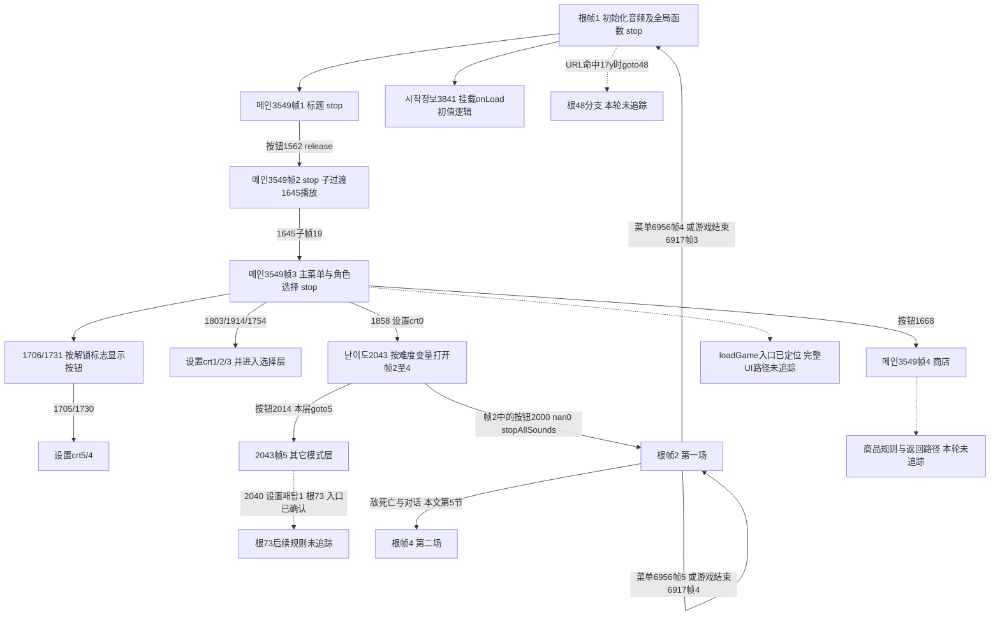
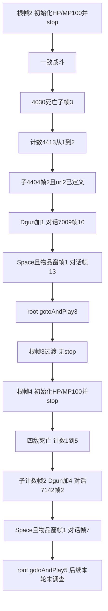

# 工单 01 原作行为依据

调查日期：2026-11-11。本文是本轮 `crt=0`、根时间轴帧 2 与帧 4 验证内容的静态证据记录。调查读取了原 AS、结构 XML、资源边界；**没有在原 Flash 播放器中执行这些行为**。帧事件调度、复合伤害及视觉对照仍需运行验证。工程实现与测试结果以工单交付报告为准，不能把本文的已定位规则视为全部已经实现。

资料基准：工作区为 `C:/Users/24782/Desktop/leba_project`；下文 `res/scripts/…`、`res/structure/…` 均指 **Godot 仓库之外的同级提取目录**，不是 Godot 的 `res://`。原件与提取资料只读。

- [结构 XML](C:/Users/24782/Desktop/leba_project/res/structure/game.xml)：FFDec 26.2.1 导出，版本 2.2；550×400 舞台，25 FPS。
- [原始逆向快照](C:/Users/24782/Desktop/leba_project/godot/docs/逆向报告.md)：提供总体资源规模；本轮重新核实具体实例和时间轴，不能据声明帧数推定动作。
- `DefineSprite_N` 是资源 ID，`frame_N` 是该元件自己的时间轴帧；根帧、角色父帧与子动画帧不可混用。

## 0. 启动、标题、主菜单、角色与模式入口

原作这些界面大多仍处于**根帧1**，切换的是嵌套 `메인` 的帧，不是每点击一次便换根场景。XML确认根帧1的 `메인` 为3549，`시작정보` 为3841。原作已追踪顺序为标题→短过渡→主菜单/角色→难度或模式选择→根战斗帧；Godot本轮“标题→模式→角色→场景介绍”的独立页面编排是粗框架的流程承接，不应倒推为原作页面排列已完全复刻。



实线表示本轮交叉定位了放置元件与脚本的直接入口；虚线表示仅知道跳转或相关入口，尚未完成这一分支全链调查。图中的“商店”等采用实例名称与脚本用途作结构说明，不代表本轮实现其交易或开放规则。

| 节点 | 脚本、结构证据与有效边界 |
| --- | --- |
| 根启动 | `frame_1/DoAction.as` 捕获键盘、创建BGM、加载1602.mp3并在结束后重播；设置url2、slotName、默认crt等。`DoAction_2.as` 的第一条是stop，注册saveGame/loadGame等函数。运行时回调先后尚未实测 |
| 默认值 | 3841帧1赋根onLoad初始化函数；3549帧3中2043实例的enterFrame在难度变量未定义时补初值。3841作为嵌套元件存在，并不等价于“所有初值已经先于所有其它事件执行”的证明 |
| 标题 | 3549帧1 stop，XML放置按钮1562；1562释放事件令根메인跳2 |
| 标题过渡 | 3549帧2 stop，并放置1645；`DefineSprite_1645/frame_19/DoAction.as` 令메인.gotoAndPlay(3)，主菜单帧3再次stop |
| 角色0 | 主菜单帧3直接放置1858；按钮1858根据难度变量0/1/2/3/4设置crt0和相关雷电参数，并打开 `메인.난이도` 的2/3/4帧；其中0/1会先把难度变量归2 |
| 角色1至3 | 主菜单直接放置1803、1914、1754，按钮内分别设置crt1、2、3。完整职业名、全部动作仍不由此推定 |
| 角色4至5 | 主菜单嵌套1706/1731：前者根런처==1时跳2并出现按钮1705(crt5)，后者根소울브링어==1时跳2并出现1730(crt4)。入口解锁条件有直接证据，取得该解锁的全流程未追踪 |
| 本轮战斗入口 | `난이도`=2043，帧2放按钮2000；该按钮释放时stopAllSounds、nan=0、root.gotoAndStop(2)。其它难度入口不能仅按画面相近而复制其规则 |
| 其它模式 | 2043的2014按钮执行本层gotoAndStop(5)；按钮2040令패탑=1并根gotoAndStop(73)。2043帧5的2041实例还在패탑>1时跳3，开放状态涉及跨局数据，后续规则未接 |
| 商店 | 按钮1668令根메인跳4；主菜单3549帧4放 `상점`=3548。交易、返回、装备生效全链不在本轮范围 |
| 读档入口 | 按钮2894、3005及3003帧19调用loadGame并驱动大话框；3003还令메인回3。这些证明原作有显式读档入口，未证明标题每次出现均自动读取 |
| 返回/重试 | 根2中6917与6956实例事件跳根1或根2，详见第5节。根1全局变量会重新初始化，哪些原档字段继续保留须结合函数/实例时序核验 |

因此框架可将标题、模式登记、角色登记、战斗进入和返回分为明确模块，但“原作菜单已全部还原”“所有模式已开放”“角色4/5默认可选”均没有本轮完成依据。

## 1. 本轮代表内容及时间轴定位

| 内容 | 已确认入口 | 实际可见/动作子元件 | 边界 |
| --- | --- | --- | --- |
| 角色 `crt=0` | 玩家父元件 6732 初始停在帧 1 | 4544 待机；4617 移动 | `crt=0` 是已确认编号，本文不据资源名替其确定完整职业译名 |
| X 普通攻击首段 | 父 6732 帧 7 | 4637；默认分支发射链接符号 `총알`=1474 | 装备和连段分支独立，不能把 4637 的全部声明帧顺播当成首段 |
| D 技能 | 输入元件 4068；父 6732 帧 13 | 4685；碰撞元件 4684 | 按键、MP 和事件有直接脚本依据；总伤害组合仍需实际调度核验 |
| 玩家受击 | 父 6732 帧 14 | 4686，另有透明判定 4547 | 4547 不是可见受击动画 |
| 敌人 | 根帧 2/4 放置 4030 | 内层 `속`=3898；移动绘图 3873；死亡 3897 | `mobsp` 的初始化尚未定位 |
| 第一场景 | 根帧 2 | 地图 3856，4030×1 | 正常结束经过对话 7009，再到根帧 4 |
| 第二场景 | 根帧 4 | 地图 3856，4030×4 | 正常结束进入对话 7142，再到根帧 5；后续本轮不调查 |

父 6732 帧 1 脚本将 `crt=1/2/3/4/5` 分别转到父帧 `30/64/101/146/178`。这些只是其他角色的初始段入口，不能据此宣称其完整职业、动作与技能已核实。旧报告中输入元件 4144 的 V/MP5/父帧99分支，实际允许父帧 30–33、37–41，即属于 `crt=1` 段，不能套给 `crt=0`。

## 2. 输入、移动、普通攻击

### 2.1 输入与移动

来源：`res/scripts/frame_2/PlaceObject3_6732_909/CLIPACTIONRECORD onClipEvent(enterFrame).as`。

当玩家父帧 `<=4`，每次源 `enterFrame` 检查右键 39、左键 37，分别将根实例 `_x` 加/减 6，设置 `bug1=+1/-1`、父帧跳至 2，改变 `_xscale` 符号。按住移动是逐源帧检查；25 Hz 下对应名义 150 舞台单位/秒，不能把 6 直接套到 Godot 的任意渲染/物理更新频率。两方向是两个独立 `if`，同时按下时的源处理顺序为右后左。

X 来自 `DefineSprite_6732/frame_1/PlaceObject2_4544_7/…keyDown.as` 与移动子元件对应 `keyDown`：`Key.isDown(88)` 时父 `gotoAndPlay(7)`。这是按键事件内检查按住状态，尚未核验 Flash 宿主重复按键事件频率。粗框架若采用 Godot 单次按下和明确连按队列，应记录为输入承接方案，不能声称已逐项复现宿主键盘重复行为。

### 2.2 X 首段实际序列

来源：`res/scripts/DefineSprite_4637/`。

- 帧 2：`weaponmaster==1` 跳 28；否则 `스핏무기==9` 跳 20。这两种为装备分支。
- 默认帧 4：`gotoAndPlay(6)`；帧 5 不是默认自然播放的一帧。
- 帧 6 的碰撞元件 439 对行动身体命中设置敌 `중력=-5`、`중력가속도+=0.1`，本节点没有直接普通伤害扣减。
- 帧 8：`i=0; _root.일.attachMovie("총알","총알"+i,i); i++`。该链接符号在 XML `ExportAssets` 对应 1474。
- 帧 19：玩家父 `gotoAndPlay(1)`。在帧 10 与 19 的按键节点还存在 X→父帧 8 的连段入口；后续连段不属于本轮首段验证范围。

默认播放路径应尊重 `1→2→3→4(跳6)→…→19`，不能机械用 `19/25` 宣称准确动作时长，也不能把特殊帧 20–42 加到首段里。跳帧在源宿主内的同 tick 执行顺序待运行对照。

### 2.3 子弹与普通伤害链

来源：`DefineSprite_1474_총알/frame_1/PlaceObject2_542_1/` 的 load/enterFrame；敌实例 `…enterFrame)_24.as`。

子弹内部 `속`=542，load 初始化 `hita,hita2,…hita5=0`。每个目标命中标记为 0 且与该敌 `속.행동몸빵` 相交时，设置敌 `중력=-5`、加速 `+=0.1`、令 `공중.타격.gotoAndPlay(2)`，并把该目标的 hita 标记设为 1。敌自己的事件看到 `공중.타격._currentframe==2` 扣 `hp-=5`。**每颗子弹、每个目标的去重是明确源码事实**；其它动作不能因此自动推广同一规则。

子弹还有冻结、霸体、装备附加特效及 `passper` 随机分支，本轮默认分支不等于这些组合都已还原。

1474 的 XML 时间轴共 11 实帧，542 的 x 平移 twips 为：

```text
帧       1     2     3     4     5     6     7     8     9     10
tx    2060  2725  3391  4058  4724  5390  6056  6723  7389  8056
ty     -75   -75   -75   -75   -75   -75   -75   -75   -75   -75
```

其局部缩放约 `(1.2251,1.63385)`；帧 11 移除 depth 1 并 stop。可见/判定存在于 1–10 帧，约 0.4 秒源时间，每源帧约 33.3 父单位位移。它 attach 在玩家实例下，还须应用玩家根缩放及翻转；不能把局部 33.3 当成舞台位移。帧 11 没有 removeMovieClip，原容器与深度复用的完整生命周期尚未运行确认。

## 3. D 技能与命中事件

直接输入证据：`res/scripts/DefineSprite_4068/frame_1/PlaceObject2_4051_1/CLIPACTIONRECORD onClipEvent(keyDown).as`。

按 D（68），允许玩家父帧为 `14`、`<5`、`7..10` 或 `16`；MP 至少 5 则扣 5，玩家转父帧 13；否则令 `게임오버.부족.gotoAndPlay(2)` 显示不足。`thereisnospoon!=1` 时技能栏 `크로스모어.gotoAndPlay(2)`，技能栏时间轴承担原技能反馈/可输入节点的生命周期，不能只凭名称臆造统一技能冷却。

4068的XML声明和实际均为126帧：帧1 stop且输入节点4051存在，帧2移除4051并换为冷却图形4067；除帧1 stop外无其它DoAction，播放到126后循环回1。因此默认D使用后的不可输入段为2–126，共125个源帧，即约5秒；这是具体技能的结构依据，不能推广为所有技能统一5秒。`thereisnospoon==1`跳过技能栏播放，属于特殊分支。

父 6732 帧 13 stop，可见子元件为 4685。其普通分支帧 22 返回玩家帧 1。特殊武器或 `weaponmaster` 在子帧 2 跳至 23，终止在帧 44，属于本轮未接的装备分支。

### 3.1 判定窗口与运动

4685 帧 8 放置 4684、depth 121；帧 9–15改变其变换；帧 19 移除。因此默认判定窗口为 **子帧 8–18**，不是只在第一张特效图出现时瞬间判定。4684 原形状 bounds twips 为 `[-1329,-868,1329,868]`。

| 子帧 | tx（twips） | ty（twips） | scaleX | scaleY（约） |
| --- | ---: | ---: | ---: | ---: |
| 8 | 2630 | -788 | 0.71647644 | 3.8215332 |
| 9 | 3952 | -771 | 0.7133026 | 3.8214722 |
| 10 | 5276 | -754 | 0.7101135 | 3.8214722 |
| 11 | 6599 | -736 | 0.7069397 | 3.8214722 |
| 12 | 7923 | -719 | 0.7037506 | 3.8214722 |
| 13 | 9246 | -701 | 0.7005768 | 3.8214722 |
| 14 | 10569 | -684 | 0.6973877 | 3.8214722 |
| 15–18 | 11046 | -696 | 0.69421387 | 3.8215332 |

在此基础上再加父 6732 中 4685 的偏移 `(-892,17)` twips，并应用玩家根缩放/翻转。此技能命中区沿前方移动，固定近战矩形会改变其实际射程。

### 3.2 伤害与受击链

`DefineSprite_4685/frame_8/PlaceObject2_4684_121/`：load 设 `mr,mr2,…mr5=0`。对某敌行动身体相交且 `mr<1` 时，设置重力 `-5`、加速 `+=0.1`、触发敌 `공중.타격` 帧 2，并 `mr++`；对其它目标有独立标记。

同一节点 `enterFrame)_16.as`（敌 1；后续文件对应敌 2–5）看到敌 `공중.타격` 帧 2 时扣 **70**。敌自身公共事件同样在该标记帧扣 **5**。由静态事件组合推得默认命中总计 **75**，但这依赖 Flash 事件调度、该标记停留时间和其它命中的并发关系，**75 是静态组合推断，不是已测原作伤害**。特殊武器 9 还有额外 100 分支，不能泛化到默认技能。

`mr` 控制碰撞触发次数，但追加 70 的脚本只读敌标记帧，不再次检查本技能 mr 或相交。因此粗框架若将二者合为一次 75 并按“动作/目标”去重，是明确的本轮承接：它避免重复结算，但原多个技能、子弹同 tick 命中的共享标记效应还需继续逆向和运行验证。

## 4. 敌人 4030、玩家受击、死亡

根帧 2 的脚本目录为 `res/scripts/frame_2/PlaceObject3_4030_222/`，根帧 4 的四个对应目录末尾为 `224/705/1142/1389`。

| 行为 | 直接事实与证据 |
| --- | --- |
| HP | load `_2.as` 设置 `hp=hpm=200`；本轮五个实例均如此 |
| 追逐 | enterFrame `_7.as` 在内层帧 1 或外层帧 2时，朝玩家 x 加/减 `mobsp` 并改变方向；全量 AS 查找尚未发现 `mobsp` 的赋值，准确追逐速度待调查 |
| 源图朝向 | 同 `_7.as` 明确：玩家在敌右侧时 `속/공중._xscale=-abs`，玩家在左侧时为正 abs。因此3898默认朝左，与crt0默认朝右相反；逻辑“向右=+1”不能直接作为两者共同的绘图/局部判定镜像符号 |
| 接近辅助 | `_5.as`：玩家重力身体与 `속.이동히트` 相交时 x 向玩家加/减 2；不得将其直接替代所有追逐速度 |
| 攻击触发 | `_8.as`：`속.근거리` 与玩家 `중력몸빵` 相交→`속.gotoAndPlay(5)` |
| 近距区寿命 | 3898 中 `근거리`=1119 在帧 1 放置，帧 4 移除；进入攻击后不是持续每帧重置到 5 |
| 攻击动作 | 内层 3898 帧 5 play；帧 50 跳回 2；移动子绘图 3873 并非整个敌人静态父帧 |
| 攻击有效窗 | 3898 帧 26 放置 `몬공`=3875，27/28 改变变换，29 移除；有效 26–28，共 3 源帧 |
| 命中玩家 | `_19.as`：玩家 `몸빵` 与 `속.몬공` 相交时，`crt=0` 父帧改为 14；其它 crt 有不同受击帧，不是同一动画 |
| 玩家扣血 | `_22.as`：玩家 `맞는중` 帧 2 时根 `hp-=10`；`_20/21.as` 还在相交时将玩家 x 推开 10 |
| 玩家受击结束 | 4686 帧 2 驱动玩家 `타격`；帧 14 返回玩家父帧 1；透明 4547 另负责边界限制 |
| 敌受击分支 | 玩家 `동작.밀림` 等命中行动身体→3898 帧 51；`붙`→53；冻结分支→63；各分支不能用任意统一硬直宣称完全还原 |
| 敌死亡 | `_23.as`：`hp<=0`→血条帧 2、内层 `속.gotoAndStop(64)`；64 中 `죽음`=3897 |
| 死亡计数 | `_32.as`：`속.죽음` 子帧 3 时 `남은수.nextFrame()`；死亡 3897 在帧 15 stop |
| 金币 | 死亡子帧 3且 `nan=0/1/2/3/4`，分别增加 `100/120/150/170/200`；只代表本敌实例规则 |

敌 hitbox3875 原 bounds 为 twips `[-1224,-1146,1213,1146]`。在3898的三帧矩阵：26为 tx=-263,ty=-305、无缩放；27为 tx=-244,ty=-12、scale(1,.590744)；28为 tx=-584,ty=221、scale(.750412,.3438263)。然后叠加4030内层3898偏移 `(0,-1325)` twips与根实例缩放/翻转。

死亡计数读的是短暂子帧，并非源代码中的显式 settled 布尔值；Godot 用一次死亡结算状态避免重入是框架实现要求。其结果应与原每敌只增长一次的正常路径比对，不得因重复调用重复发奖。

### 4.1 重力、落地与边界

敌基础 enterFrame：`_Y += 중력 + 중력가속도`；当 `중력<=30`，每源帧 `중력+=1`。本轮普通子弹/D命中将其设为 -5，附加加速 0.1。地面不是绘图背景：`frame_2/PlaceObject2_4393_686/…enterFrame.as` 检查敌 `중력몸빵.hitTest(this)`，成立后重力和加速归零，敌 `_y` 设为该地面实例 `_Y`。根帧 4也有对应4393地面实例。

敌墙体规则用 `_root.wall.hitTest(行动身体的根坐标xMax/xMin,enemy.y,true)`，命中后向内推 10。玩家父受击帧 14的4547节点对 x 使用 `[_width/2,550-_width/2]`，对 y 使用 `[_width/2,400-_width/2]`。这里 y 也用了 `_width`，应忠实记录而不是自动“修正”源码为 height。

本轮根帧2/4未定位必须滚动的摄像规则；固定550×400舞台是合理承接，但完整镜头、墙形精确点测试与击飞调度仍需运行核验。

## 5. 场景放置、正常推进、返回与重进

以下坐标是根舞台像素（XML twips除20），不是裁剪后图片左上角。玩家原点在身体中部偏下，敌原点接近脚底，**不能把两种演员的 y 强行统一**。

| 根帧 | 实例/资源 | 根位置 | 根缩放 |
| --- | --- | --- | --- |
| 2 | 玩家 `일`/6732 | (129.35,312.9) | (.6369171,.65245056) |
| 2 | 敌 `적`/4030 | (411.2,363.7) | (.52941895,.51246643) |
| 2、4 | 地图 `맵`/3856 | (279.35,311.2) | (1,1) |
| 4 | 玩家 `일`/6732 | (273.35,314.9) | (.6369171,.65245056) |
| 4 | 敌 `적`/4030 | (494.9,363.7) | (.52941895,.51246643) |
| 4 | 敌 `적2`/4030 | (411.45,363.7) | 同上 |
| 4 | 敌 `적3`/4030 | (168.5,363.7) | 同上 |
| 4 | 敌 `적4`/4030 | (50.4,363.7) | 同上 |
| 4 | 地面 `땅`/4393 | (305.85,360.15) | (1,1) |

根帧 2 只直接放置一只4030；其它辅助元件不是多只敌人的证据。根帧 4明确放置四只4030，各自 num=1..4、HP200。背景之外还有墙、地面、角色、敌人、计数、对话、技能/HUD、辅助效果等独立元件。



证据链：

- `frame_1/DoAction.as` 明确 `_root.url2="17y"`，因此并非凭空假设第一关完成条件中的 url2 可用。
- `frame_2/PlaceObject2_4413_700/…enterFrame.as`：计数帧 2、其 `속` 帧2、url2非undefined时，Dgun增加 `当前帧-1` 并令 `대화창.gotoAndStop(10)`。计数4413帧2子元件4404，在子帧3 stop。
- 对话7009帧10 stop并把玩家父帧置17；Space（且物品窗帧1）跳其13；鼠标release为对话nextFrame。其13执行 `_root.gotoAndPlay(3)`。
- 根帧3只复位 `불장판`，无stop；根帧4脚本stop并重置HP/MP及局部状态，因此顺序推进到根4有明确来源。
- `frame_4/PlaceObject2_4413_702/…enterFrame.as`：计数到5且其子帧2，Dgun加4、对话帧2。XML确认此时对话资源是7142，而非7009；7142帧2的Space（物品窗帧1）跳7，7执行根gotoAndPlay5。根5亦只有过渡复位，之后未追踪。

返回/重试也有明确入口：根2游戏结束元件6917的根实例事件，自身帧3→根1、帧4→根2、自身帧2→根72；菜单元件6956的根实例事件自身帧4→stopAllSounds并根1、自身帧5→stopAllSounds并根2。框架的菜单返回、重进应清理对象/计时器/碰撞；**根4之后改为本轮结果页返回菜单属于测试内容边界，不能标作原作结局**。死亡根72分支的完整复活/结算尚未调查。

## 6. 碰撞坐标与素材锚点核对

结构矩阵与精确FFDec边界由资源接入任务交叉核对。矩形均写为 `[x,y,width,height]`；形状包围盒用于还原时仍须注意原 `hitTest` 参数是否使用精确形状。

| 判定 | 元件与父变换 | 代表性结果 |
| --- | --- | --- |
| 玩家身体/重力身体 | 4546/4547 bounds twips `[-658,-2790,658,30]`，6732内偏移(94,1449)twips | 玩家局部 `[-28.2,-67.05,65.8,141]`；根帧2初始 `[111.38894,269.15319,41.90915,91.99553]` |
| 敌重力身体 | 1119 bounds `[-965,-1919,1132,1530]`twips，4030内scale(.9993286,.9997101)、偏移(-15,-1552)twips | 敌局部 `[-48.96760,-173.52218,104.77960,172.40001]`；根2 `[385.27562,274.77571,55.47231,88.34922]` |
| 敌行动身体 | 同1119；3898内scale(.9993286,.9997101)、偏移(-155,-229)twips；3898再偏移(0,-1325)twips | 使用行动身体而非整个PNG透明画布检测玩家攻击 |
| 敌近距触发 | 3898内1119偏移(-94,39)twips，再叠3898偏移 | 原点、翻转随敌方向；不是玩家与敌图片中心的任意距离 |
| D帧8判定 | 4684与第3节矩阵 | 玩家局部 `[39.29014,-204.40454,95.21972,331.70908]`；根2 `[154.37456,179.53614,60.64707,216.42378]` |
| 敌帧26攻击 | 3875及第4节矩阵 | 敌局部 `[-74.35,-138.8,121.85,114.6]`，仍需根scale/facing |

原 PNG 的透明留白、父元件嵌套首帧、裁剪偏移和根缩放是四种不同概念。完整父时间轴PNG可能只显示子元件首帧，不能拿6732某一帧的PNG代表内部动画持续播放。转换应保留具体子元件原 bounds 与 placement，运行时在动作切换后使用同一演员原点。

### 6.1 默认装扮选择器与派生渲染

静态渲染如果不执行嵌套 AS 的 `stop/gotoAndStop`，会把装扮选择器的不同帧顺播成帽子、身体或翅膀轮换；这不是原动作换装。资源任务定位的默认选择器包括3572、3588、3597、3602、3610、3641、3674、3678、3679、3688。

`DefineSprite_3841/frame_1/DoAction.as` 设置根 onLoad 初始化函数，其中 `스핏압=1`、`스핏마스터=0`；`DefineSprite_3549/frame_3/PlaceObject2_2043_336/…enterFrame.as` 在初始难度变量未定义时也初始化这些值。根帧2/4明确 `pren=0`。3588帧1先隐藏 `wing` 与 `전펙`，仅 `wing==1` 显示翅膀、`스핏마스터==1 && crt==0` 显示另一效果。初始化未明确为wing赋0，新无存档路径通常为undefined，仍不满足显示条件。

因此本轮默认装扮派生渲染可以冻结上述选择器的默认帧、隐藏3588的两个效果实例；转换方法与源ID必须留在资源清单，不能修改原SWF，也不能据此宣称支持所有存档装扮。其它选择器的具体首帧条件由资源导入脚本记录并核对。

### 6.2 明确的音效帧事件

以下来自 XML 中对应元件的 `StartSoundTag`，不是根据音频文件名猜用途。音量 envelope 数值为原 SWF 声道级别；若Godot仅用统一音量，应记录为尚未逐声道还原。

| 时间轴 | 事件帧 | DefineSound ID | 参数 |
| --- | ---: | ---: | --- |
| X首段4637 | 7 | 4421 | envelope L12399/R13875 |
| D4685 | 2 | 4678 | envelope L12694/R11808 |
| D4685 | 5 | 4458 | inPoint3900，envelope L13284/R12694 |
| 敌攻击3898 | 27 | 3876 | 无额外envelope，非循环 |
| 敌死亡3897 | 13 | 3896 | 两条pos44=0 envelope，先L3227/R5461、后L7696/R9185；同点处理需核验 |
| 玩家移动4617 | 7 | 4616 | 无额外envelope |

4686本身没有StartSound；若需要受击音，须进一步追踪其嵌套 `타격`，不能任选一个命名相似的文件。SoundStreamHead2的零sampleCount空流不是可播放音效。特殊X帧27/28和D帧24/27也有其它事件，均不属于本轮默认分支。

## 7. 事实、推断、暂定承接与后续调查

**静态确认**：角色编号入口；crt0的左右6/源tick；X首段入口与子弹1474；D消耗5、输入状态门槛、4685/4684有效窗与矩阵；普通命中标记公共5、技能追加70；敌HP200、攻击有效26–28、玩家公共受击10；死亡子帧3计数；第一关一敌、第二关四敌及对话推进；原矩阵与形状bounds。

**静态推断、待原作实测**：D合计75；源跳帧折算的实际总动作时长；子弹/伤害标记与敌clip事件的精确同tick顺序；碰撞包围盒在所有旋转/翻转/状态下的等价程度。

**粗框架如采用必须注明的临时方案**：未知 `mobsp` 的追逐速度；只接单段X而不完整连段；技能每动作每目标一次最终伤害；固定硬直/简化击飞；冷却反馈重绘；未接后续关卡时的结果页和返回菜单；角色未还原入口的禁用状态。原作存在D可在父14受击段启动的条件，若框架暂不支持受击取消，也须列作偏差。

**规则已定位但尚未要求全部实现**：第二阶段以后对话入口；角色其它初始段；X连续段；Z元件4064→父5、MP3、动画4622及其抛空/10ms间隔Flying函数；S/Q/V等crt0技能门槛；冻结/霸体、武器特效、难度奖励、原物品窗和对话UI。Z没有在输入处直接给定通用伤害，不能顺手复制D伤害。

**还需继续逆向**：`mobsp` 初始化/实际生效途径；所有职业的正式名称和完整技能表；共享命中标记并发行为；连段取消、重复命中与无敌；完整墙形/地面在不同场景的判定；后续关卡和隐藏分支；原运行事件时序；完整装备加成对HP/MP/伤害的影响。

本调查只对原资料做读取，新增本文件。没有运行原SWF、没有修改原始资源、没有完成原作运行对照，也没有以解析成功替代Godot实际玩法验收。
