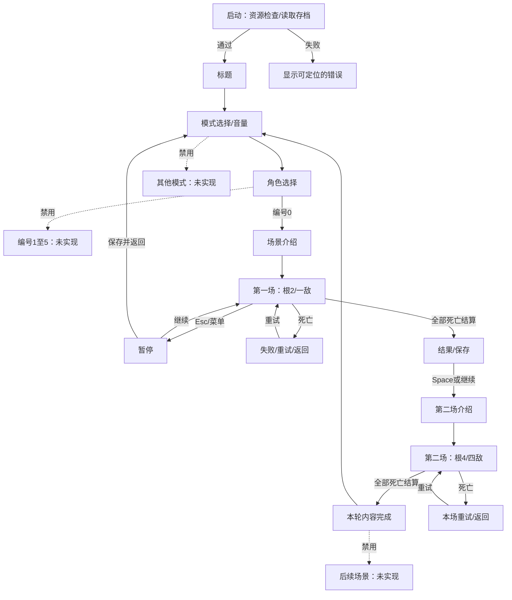

# 工单01 架构与流程

本轮建立 GDScript 粗框架，用原作 `crt=0`、根帧2/4的内容贯通全流程。原作证据与未知见[原作依据](工单01_原作依据.md)，原始调查快照仍保留，不作为当前实现清单。

## 启动与当前流程

入口为 `project.godot → scenes/main.tscn → scripts/main.gd`。启动先检查资源目录、读取本工程存档，再配置音频、显示标题。缺少必要动画/纹理/音频时显示具体资源错误。原版完整菜单、难度、对话和装备界面尚未复刻；本轮选择页、介绍页、HUD和结果页是承接这些流程的界面。

第二场也支持同一暂停和返回流程。第一场到第二场具有源计数、对话、根帧跳转依据；用结果页代替原对话、第二场结束后返回菜单，是本轮内容边界，不是原作结局。原作完整启动和菜单分支见原作依据中的独立源流程图，不能将上面的实现流程冒充原界面顺序。

## 模块与状态归属

| 文件/模块 | 职责 | 拥有的状态 |
| --- | --- | --- |
| `scripts/main.gd` | 启动检查、页面路由、场景生命周期、连接服务 | 当前页面、选中场景、服务引用 |
| `core/content_db.gd` | 内容注册表、来源参数、入口启用状态 | 只读角色/动作/敌人/场景定义 |
| `core/game_session.gd` | 跨场景档案、当前单局、死亡和完成结算 | profile、run、结算去重 |
| `core/source_clock.gd` | 把物理delta换成25Hz源逻辑tick | 累积时间；不持有玩法值 |
| `combat/battle.gd` | 统一输入、敌行为、伤害、投射物、场景推进 | 本场演员/子弹、暂停、事件记录 |
| `combat/combatant.gd` | 统一动作、生命、资源、朝向、逐目标去重 | hp/mp、动作帧、技能冷却、受击/死亡 |
| `combat/source_sprite.gd` | 图集绘制与原点复原 | 当前动画/显示帧 |
| `ui/game_ui.gd` | 显示状态、发出意图 | 界面节点和短暂提示；不拥有HP/金币 |
| `services/audio_director.gd` | 音乐、循环、音效声部、音量 | 实际播放器状态 |
| `services/save_store.gd` | 校验、保存、读取、坏档保留 | 文件状态；不独立维护游戏进度 |

档案 `profile` 保存音量、模式/角色选择、场景通关次数、金币、预留解锁和装备字段。`run` 保存本场编号、剩余敌人、源tick、获得金币、结果。演员保存生命/MP/动作，HUD直接读取演员快照。每只敌人的奖励只在死亡动画源帧3结算一次；场景完成也单独去重。退出场景移除整棵战斗节点、投射物和输入缓存，重进创建新演员，按根2/4各自初始化100HP/100MP。

## 时间与输入

- 舞台550×400，窗口默认1100×800；Godot物理更新60Hz，显示刷新率不强制25。所有源逻辑由累加器驱动25Hz，一次物理更新可运行0或多个源tick。
- 左右按住每源tick读取轴，默认角色移动6舞台单位/tick。X/D只接受新按下，忽略宿主echo；动作中无效输入不会攒成隐藏攻击队列。原X后续连段、宿主重复事件和双方向优先级未完整复现。
- X首段显式跳过源帧5，源帧8产生子弹。子弹使用原平移序列，1–10可见，第11清除；每目标独立去重。
- D扣5MP、125源tick冷却；允许idle/move/basic/hit启动，窗口8–18；可在受击时启动对应原父14许可。75伤害为5+70的静态组合推断，保留运行核验边界。
- 敌攻击窗口26–28，死亡帧3结算、帧13音效；默认画图朝左，逻辑朝向与绘图/判定翻转通过同一映射转换。
- Esc暂停清空按下缓存和累加时间，恢复不会补算暂停期间逻辑。普通运行失焦也暂停；自动化使用独立的测试模式避免窗口焦点影响。

## 场景与资源

磁盘 `../res` 是完整提取资料，Godot `res://` 指本仓库。运行不依赖原SWF和整套资料；只有重新生成派生资源时才需要它们。当前角色/敌人/背景均从原实例位置、缩放和注册点绘制；图集裁剪保留pivot，森林使用atlas region避免把留边当画面。

场景不是只有背景图片：演员、行动/受击区、技能运动、投射物、地面、敌计数、退出清理均独立运行。根2/4的地面Y采用原360.15；固定舞台边界35–520、简化击飞/落地与敌追逐2/tick是暂定承接。尚未还原原墙形逐点检测、所有遮罩/滤镜、命中标记并发调度。

## 后续接入方式

1. 在来源说明中记录新增内容的脚本、资源ID、帧事件、变换和未知项；先明确是原事实、静态推断还是临时参数。
2. 修改 `tools/import_runtime_assets.py` 的显式选取项，生成小范围运行素材及 `data/asset_catalog.json`；保留原始偏移、源哈希和转换方法。
3. 在 `content_db.gd` 注册角色ID、动作序列、事件和能力，或新增敌定义；沿用现有输入意图、伤害和结算链。新玩法事件在统一战斗处理处扩展，不能在UI另扣生命/MP。
4. 新场景登记角色/敌位置、地面/边界、结束依据、next_stage。新增模式指向已可运行首场景；未就绪入口保持禁用并说明原因。
5. 自动化回归贯通菜单到保存；再用实际窗口校验显示/翻转/输入，最后单列原作运行对照。仅导入素材不得启用入口并宣称玩法完成。

存档不读写原Flash SharedObject，也不承诺兼容。音频和字段调查见[存档与音频](工单01_存档与音频.md)。
