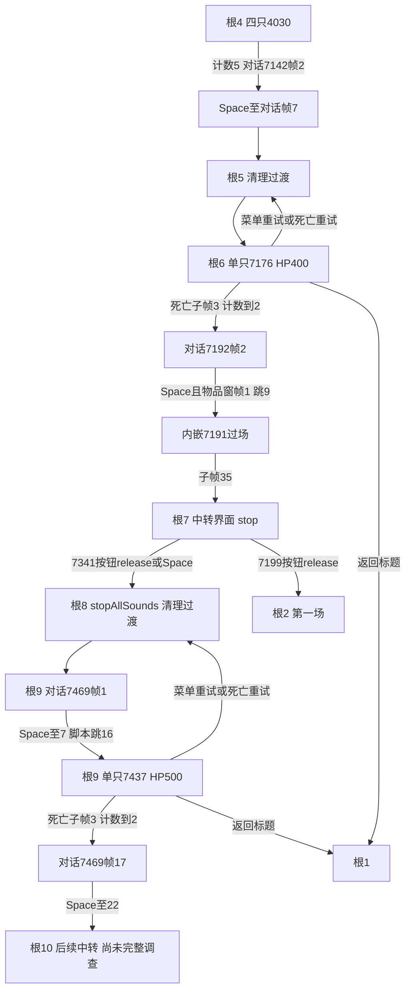

# 工单 02：关卡、敌人及推进依据

调查日期：2026-11-11。本文记录原资料静态调查、实现建议及末节明确注明来源的 Ruffle 探针日志复核，**不是实现完成清单，也不是原生 Flash 运行对照结果**。实际接入范围、动态探针和 Godot 回归以本轮主交付报告为准。已阅读项目 `AGENTS.md`、工单 01 原作依据及现有资料；未更改原始 SWF、提取资源或现有运行时代码。

## 1. 路径、帧与证据等级

工作区根目录是 `C:/Users/24782/Desktop/leba_project`。下文所有 `res/scripts` 和 `res/structure` 均为 **Godot 仓库外**的提取目录，不是 Godot 的 `res://`。

- 结构依据：[game.xml](C:/Users/24782/Desktop/leba_project/res/structure/game.xml)。用 XML 流式解析核对根时间轴、DefineSprite、ShowFrame、放置/移除、矩阵、形状边界和声音事件；未修改 XML。
- 脚本依据：[提取 AS2 目录](C:/Users/24782/Desktop/leba_project/res/scripts)。下文相对脚本路径以此为根。
- 前期依据：[工单 01 原作依据](C:/Users/24782/Desktop/leba_project/godot/docs/工单01_原作依据.md)。本文补充根 6、7、8、9，修正把敌移动辅助值当成恒定追逐速度的理解。
- `fN` 是所在元件自身帧号；根帧、敌外层帧、敌 `속` 内层帧、死亡子帧不能互换。原作舞台 550×400，时间轴 25 FPS。
- **直接事实**：脚本赋值/条件、结构放置/矩阵。**推断**：多个事件合成的最终效果、事件先后与实际总时长。**未验证**：宿主事件调度、原 Flash/Ruffle 差异、实际命中次数与视觉对照。

为减少超长路径，下文 `E6` 指 `frame_6/PlaceObject3_7176_458/`，`E9` 指 `frame_9/PlaceObject3_7437_294/`；“事件 `_N`”指各目录内 `CLIPACTIONRECORD onClipEvent(enterFrame)_N.as`，无编号为同名前缀的基础文件。load 文件采用 `onClipEvent(load)`。

## 2. 已确认的关卡顺序和退出

根 8 不是一场战斗。它是清理过渡帧，自动进入根 9。根 7 是可操作的中转界面；不能把根 6 胜利解释为原作结束。



| 节点 | 确认依据与实现注意 |
| --- | --- |
| 根 5、6 | `frame_5/DoAction.as` 是过渡，根 6 的 `DoAction.as` stop 并重置 `hp=hpm=mp=mpm=100`、`bug1=1` 及多种局部技能/效果变量。重进必须重新初始化此场 |
| 根 6 完成条件 | `frame_6/PlaceObject2_4413_455/…enterFrame.as`：计数自身帧 2 且其 `속` 帧 2 时，`Dgun += 当前帧-1`（此处为 1），令对话跳 2 |
| 根 6 对话 | 对话为 **7192**，不是第一场的 7009。f2 stop、玩家父帧17、辅助射击对象归1；该帧 Space 按钮进入对话 f9，鼠标为 nextFrame |
| 根 6 过场 | 对话 f9 放置子元件 **7191**，位置 `(-16,-2772)` twips，并触发 sound1644。`DefineSprite_7191/frame_35/DoAction.as` 才执行 `_root.gotoAndStop(7)`。35 帧名义时长约 1.4 秒；首帧/跳帧同 tick 调度仍需实测 |
| 根 7 | `frame_7/DoAction.as` 执行 stopAllSounds、stop、复位地火。7341 按钮 release/Space 执行根 gotoAndPlay8；7199 release 执行根 gotoAndPlay2；7345 打开 `_root.메인.인벤토리.gotoAndStop(2+crt)`。物品栏全部功能未据此宣称已调查 |
| 根 8、9 | 根 8 stopAllSounds、复位地火，无 stop；根 9 stop、重新初始化 HP/MP100，并将计时相关字段 `t/ts/time/ct/cleartime` 归零，`BGM.loadSound("BGM/7130.mp3",true)` |
| 根 9 开场 | 对话 **7469** f1 stop、玩家父17；Space→f7，f7直接跳16；f16 stop、玩家父1并恢复相关敌动画。源码同时操作敌2..5，不代表本场实际存在这些敌：根 XML 仅放置一只7437 |
| 根 9 完成 | `frame_9/PlaceObject2_4413_1011/…enterFrame.as`：计数2且子帧2→Dgun加1、对话17。对话17 stop并冻结玩家，Space→22；`DefineSprite_7469/frame_22/DoAction.as`→根10 |
| 其它对话分支 | 7469 f8 Space→10，f11 HP=0并stop；f12 Space→16；f21 Space→22。这些是已定位节点，触发完整条件未闭合，不能把默认Space路径外的失败对话编成必经流程 |

返回/重试检查了各实例的全部事件文件，而非只看无后缀文件：

| 场景 | 菜单实例 | 死亡实例 | 规则 |
| --- | --- | --- | --- |
| 根6 | `frame_6/PlaceObject2_6956_2794` | `frame_6/PlaceObject2_6917_2749` | 菜单自身4→根1并令主菜单イントロ296；菜单自身5→stopAllSounds、BGM.start、根gotoAndPlay5。死亡自身3→根1；自身4→BGM.start、根gotoAndPlay5 |
| 根9 | `frame_9/PlaceObject2_6956_2877` | `frame_9/PlaceObject2_6917_2832` | 菜单自身4→根1/イントロ296；自身5→stopAllSounds、根gotoAndPlay8。死亡自身3→根1；自身4→根gotoAndPlay8 |

根 6/9 不能照搬根 2 的死亡事件第三文件去宣称存在相同根 72 复活入口；本次所查对应实例各只有两个事件文件。关卡应通过数据登记自己的重试目标，复用同一场景清理流程。

## 3. 根放置与场景逻辑

坐标是舞台原点，单位像素（twips÷20）；不是裁剪 PNG 左上角。敌内层动作的偏移另见各节。背景、墙、地面、计数器、对话和时间控制器是独立实例。

| 根帧 | 实例 / ID | 舞台位置 | 根缩放 |
| --- | --- | --- | --- |
| 6 | `wall` / 7131 | (268.9,211.65) | (1,1) |
| 6 | 地图 / 3856 | (279.35,311.2) | (1,1) |
| 6 | 地面 / 4393 | (305.85,360.15) | (1,1) |
| 6 | `적` / 7176 | (345.45,364.15) | (.55415344,.54756165) |
| 6 | 玩家 / 6732 | (101.95,314.9) | (.6369171,.65245056) |
| 6 | `적랜덤` / 7178 | (288.45,589) | (1,1)，场外计时元件 |
| 6 | 对话 / 7192 | (277.8,336.6) | (1,1) |
| 9 | `wall` / 7131 | (268.9,211.65) | (1,1) |
| 9 | 地图 / 7370 | (302.35,88.6) | (1,1) |
| 9 | 地面 / 4393 | (305.85,360.15) | (1,1) |
| 9 | `적` / 7437 | (471.3,364.55) | (1,1) |
| 9 | 玩家 / 6732 | (92.9,315.9) | (.6369171,.65245056) |
| 9 | `적랜덤` / 7440 | (288.45,613) | (1,1)，场外计时元件 |
| 9 | 对话 / 7469 | (278.5,336.55) | (1,1) |

根 6/9 地面 4393 的透明度是 15/256；它负责逻辑碰撞，不应因为图片近乎透明便删除。原地面脚本使落地敌重力及加速度归零，并将敌 y 设为地面 y。初始敌位置稍低于360.15，并不证明地面在364附近。敌移动与击飞必须采用同一原点约定。

根 9 地图7370实际两帧，f1 stop；内部有缩放、斜切、滤镜和多个层级，不能把全部地形逻辑推成其 PNG。此调查只确认初始地图状态，第二状态的切换用途未闭合。根 6/9 各一只敌是根时间轴结构事实；目前所查刷怪相关脚本未发现为这两场动态添敌的入口，**没有据此建立“多波次”规则**。

## 4. 4030 校准：有条件的 2 不是全程追逐速度

`frame_2/PlaceObject3_4030_222/…enterFrame_5.as`：只有玩家 `중력몸빵` 与敌 `속.이동히트` 相交时，敌 x 才朝玩家加/减 **2/源tick**。`_6` 同条件令内层播放2、重力设为极小正数。`_7` 在内层帧1或外层帧2时执行另一条 `x ±= mobsp` 并转向。

全量 AS 大小写不敏感检索找到多处 `mobsp` 读取，未找到 `mobsp = …` 赋值；仅凭此不能证明源运行值为0、NaN或任意固定值。仍需原作动态探针记录值和坐标变化，不能为补齐追逐而把移动辅助2套到所有距离。

XML 的3898 f1放置 `이동히트`=3858，形状3857 bounds为 `[-3884,-2061,3884,2060]` twips，局部平移 `(-3974,-297)`，再加4030内3898的 `(0,-1325)`。换算4030局部矩形为 `[x=-392.9,y=-184.15,w=388.4,h=206.05]`，再按根缩放和朝向映射。根2初始敌411.2、玩家129.35，在触发范围外；原作远距离站立不动不能直接判断为播放器故障。

结构上移动触发、近距触发在内层f4移除；不能每tick无条件重新进入攻击。源敌绘图默认朝左：玩家在右侧时内层 `_xscale=-abs`，左侧时为正，和玩家默认朝右相反。

**可实施的已确认修正**：仅在已验证移动区相交时使用2；根据原近距区进入攻击；保留 `mobsp` 未确定项。准确源宿主对未定义数值和属性写入的处理、初始事件执行顺序交由动态验证结论覆盖，不能静态冒充已测事实。

## 5. 新敌 7176：根 6

### 5.1 AI、受击、死亡与奖励

| 行为 | 直接事实 / E6事件 |
| --- | --- |
| HP与编号 | load `_2`：hp=hpm400；基础load：num1，重力/加速度0 |
| 重力 | 基础enterFrame：y+=重力+加速度，重力<=30时每tick加1；落地由4393负责 |
| 移动 | `_5`：移动触发区与玩家重力身体相交，x向玩家±3；`_6`同条件播放2并设置极小重力。`_7/_8`针对玩家狙击动作相交使用±5及播放2，不是所有情况统一速度5 |
| 朝向 | `_9`：内层1或外层2时按玩家相对位置翻转内层，并x±mobsp。mobsp赋值仍未知 |
| 行为入口 | `_11`近距→7170 f6；`_12`远距→f46；`_13`检查名为필살기的触发区并跳66，但在7170结构里未找到该命名放置，不能创造其触发距离 |
| 边界 | `_26/_27`使用wall形状精确点测试，命中后内推15；不能用图像边框代替原墙 |
| 受击 | `_28/_29`玩家밀림→f99；`_30`붙→101；`_31/_32`밀림相交时向远离玩家方向推30。冻结→110、解冻返回1是单独分支 |
| 普通命中玩家 | `_33`身体与몬공相交，按crt选择玩家受击父帧；crt0→14，同时令 `맞는중.gotoAndPlay(2)` |
| 玩家掉血 | `_37`读玩家맞는중帧2，根hp减 **3.5**。生命数据不能整数化 |
| 玩家击退 | `_35/_36`蒙攻重叠时将玩家向外推10/源tick；源码不是“整个敌动作只推一次” |
| 击倒分支 | `_34`名为넉다운的区相交→各角色倒地段并玩家공중2；在7170所查结构没有该命名区，不应据公共代码虚构这只敌的击倒攻击 |
| 敌受伤公共链 | `_39`敌공중.타격帧2扣5；`_40`샷标记帧2额外扣20；冻结另有5/10扣血。这些条件不能合并为所有玩家攻击25 |
| 死亡 | `_38`hp<=0→血条2、inner7170 f112、根计时器7178停止于1；112内死亡7169 |
| 结算 | `_46`死亡7169子帧3→计数nextFrame并复位若干附着辅助；`_47..51`同子帧3按nan发奖。7169 f10 stop，f6音效3896 |
| 金币 | nan0/1/2/3/4分别 **300/350/400/450/550**，没有相应HP随难度变化的赋值证据 |
| 计时动作 | 根7178共200帧，f200 stop并令敌inner111；111内7168共80帧，子f2重启根7178，子f80返回inner2 |

7168是朝反方向绘制的移动子动画，未发现显式演员x退走赋值，也未见其内部逐帧平移矩阵。不能仅凭图像把它实现成有某个退走速度的“逃跑AI”。根计时器有强制换动作行为，若只实现普通追逐与近攻，应将计时行为列作未接。

掉落脚本也存在但不能等同完整装备系统：`_67`在헤븐未拥有时使用概率 `.11+nan*.01`（nan4改用moretb）；`_68`对하링用 `.008+nan*.001`（nan4改用moretb），分别打开物品窗口5/19。是否保存、装备属性及获得流程须结合存档/物品系统继续核验，本节不建议单独伪造掉落UI。

### 5.2 动作资源和窗口

7176 内层 `속`=**7170**，平移 `(0,-1428)` twips，即 `(0,-71.4)`局部像素；根缩放见第3节。以下都是7170的帧，不是根帧：

| 动作 | 原路径与素材 | 判定/返回 |
| --- | --- | --- |
| 待机 | f1 stop，绘图7155 | 行动身体7157；移动/近/远触发区存在 |
| 移动 | f2，绘图7158共11帧 | f4 gotoAndStop1；f4移除触发区 |
| 近攻 | f6..45 | f45 gotoAndPlay2；蒙攻7163仅f10、22、34各1帧，下一帧移除；每次有sound7164 |
| 远攻 | f46..90，然后f91跳113，至130回2 | 蒙攻7163为f68..69、72..73、76..77；f52..53也放7163但**没有实例名蒙攻**，不能自动计入该命中链 |
| 受击 | f99..109 | f109回2；f101有连击计数脚本 |
| 冻结 | f110 stop，子7167 | 非普通受击结束逻辑 |
| 计时动作 | f111 stop，子7168 | 子f2重启根timer，子f80回inner2 |
| 死亡 | f112 stop，子7169共10帧 | 子3结算，子6声音，子10stop |

远攻序列中的556、7165是嵌套视觉效果；未见可证明额外独立伤害的脚本，不能根据效果图片再造一枚独立高伤投射物。动画导出须保留这些嵌套帧，不宜仅导7170单帧父PNG。

### 5.3 7176 几何数据

矩形表示 `[xmin,ymin,xmax,ymax]`，全为twips；M表示 `(tx,ty,sx,sy)`。先变换形状，再加7170父偏移 `(0,-1428)`，最后根缩放/翻转。下面判定区无旋转。

| 元件 | 原形状边界 | 7170内放置矩阵 M | 寿命 |
| --- | --- | --- | --- |
| 移动7144→7143 | [-746,-754,745,754] | (-6689,-19,8.535812,2.2271576) | f1..3 |
| 近距7144 | 同上 | (-2381,109,.55973816,1) | f1..3 |
| 远距7144 | 同上 | (-8141,109,.41142273,1) | f1..3 |
| 行动身体7157→7156 | [-813,-1179,813,1179] | (-172,121,1,1) | 普通动作；冻结/特殊状态需照原放置变化 |
| 蒙攻7163→7162 | [-921,-1380,921,1380] | (-1643,-76,1.3765106,.7328491) | f10、22、34 |
| 远蒙攻7163 | 同上 | (-3768,-1017,.7424164,1.732605) | f68..69 |
| 远蒙攻7163 | 同上 | (-5500,-1017,.7424164,1.732605) | f72..73 |
| 远蒙攻7163 | 同上 | (-8344,-858,.7424164,1.732605) | f76..77 |

外层7176重力身体仍为1119，平移 `(-15,-1552)` twips，缩放 `(.9993286,.9997101)`，不要给这个身体额外加7170父偏移。攻击命中行为取决于**对应命名实例**与脚本，不由透明形状外观相似决定。

## 6. 新敌 7437：根 9，可作为下一场依赖

### 6.1 行为、计时和难度

HP=hpm500、num1；外层7437的内层 **7427** 偏移(0,0)，根缩放1。移动触发3/源tick、狙击相关5、未知mobsp、重力和方向约定与7176相似，但不能复制其攻击/死亡数据。

| 行为 | E9证据 |
| --- | --- |
| 攻击入口 | `_11`近距→6；`_12`远距→41；`_13`평타→101 |
| 普通玩家受击 | `_33`按crt设受击帧，crt0→14；`_37`玩家맞는중2扣 **4** |
| 击倒 | `_34`넉다운区相交→玩家倒地父帧/공중2；`_38`玩家공중3扣 **5**。4与5是不同条件，不能直接写成每次伤害9 |
| 击退 | `_35/_36`몬공相交时向外推20/源tick |
| 敌受击 | `_28/_29`밀림→141；`_30`붙→143；推开30；冻结149、狙击事件150、默认标记伤害5、샷追加20分别是独立条件 |
| 死亡 | `_39`HP<=0→inner151，根timer7440停止于1；151子7426，子帧3由`_47`结算计数；7426 f7音效5625、f8stop |
| 奖励 | `_48..52` nan0..4为 **300/350/400/450/600**；nan4不同于7176的550 |
| 根计时器 | 7440有215帧；f118令inner150；f215令inner121。f150子7425 f35令inner2；不能把f150当永不结束的静态动作 |

根计时器无普通攻击冷却变量，应以25Hz源帧计数继续推进；死亡时停止。是否强制计时节点打断冻结/受击、各种同步先后和原运行观感仍需探针，不能凭“合理”重排其优先级。

掉落有스틸、크래各 `.05+nan*.01`（nan4改moretb），对应物品窗20、27；全套掉落和装备结果尚未调查，本文只给入口。

### 6.2 动作与有效窗

| 动作 | 7427帧路径 | 有效判定 |
| --- | --- | --- |
| 待机/移动 | f1stop；f2内7382共10帧；f4 gotoAndPlay1 | f1..3有AI触发区；移动绘图7382偏移(-135,480)twips |
| 近攻 | 6..29→152..155→2 | 7405蒙攻f13..21；不是把6..40全段顺播 |
| 远攻 | 41..100→30..40→1 | f54..57蒙攻7405；58..59蒙攻7412；60..62蒙攻7414；63..65击倒7405 |
| 普通 | 101..120→2 | 击倒7419 f108..111 |
| 特殊 | 121..140→2 | 击倒7421 f131..137；**行动身体在121移除，131才恢复** |
| 受击 | 141..148→2 | 敌专用受击返回 |
| 冻结 | 149stop | 独立冻结子元件 |
| 计时预备 | 150stop，子7425 | 子f35回inner2 |
| 死亡 | 151stop，子7426共8帧 | 子3结算；子7sound5625；子8stop |

音效结构事件：7427 f10=7383，f42=7406，f54/f63=169，f106=5209，f121=6089，f131=6096。f103放置7416的事件在玩家맞는중3时附加横斩视觉，但该事件没有直接追加伤害，不能按特效多算一次。

### 6.3 7437 触发和命中几何

7427默认朝左，无额外父偏移。形状7143同前；7379→7378 bounds `[-310,-600,310,20]` twips。行动身体7157→7156同前。

| 区 | M(tx,ty,sx,sy) | 备注 |
| --- | --- | --- |
| 移动7144 | (-5145,-852,6.061737,1.152771) | 初始触发区 |
| 远距7379 | f1(-4575,-340,1,1)；f2/3(-4675,-360,1,1) | f4移除 |
| 近距7379 | f1(-2518,480,2.9310303,5.137924)；f2/3 tx=-2378 | f4移除 |
| 普通7379 | f1(-300,-124,2.4396973,2.0905762)；f2/3 tx=-220 | f4移除 |
| 行动身体7157 | (-62,-799,1,.6920471) | 特殊121..130不存在 |

| 命中元件→形状 | 原边界 twips |
| --- | --- |
| 7405→7404 | [-1110,-1341,1110,20] |
| 7412→7411 | [-2250,-2670,2250,0] |
| 7414→7413 | [-1642,-2545,1642,0] |
| 7419→7418 | [-423,-1070,545,20] |
| 7421→7420 | [-2901,-2241,2901,20] |

| 帧窗口 | 实例 / M(tx,ty,sx,sy) |
| --- | --- |
| 13..21 | 蒙攻7405：(-1660,171,2.0639038,1.6659241) |
| 54 | 蒙攻7405：(-1403,155,.9268799,.93844604) |
| 55..57 | 同7405：(-2210,155,.9268799,.93844604) |
| 58 | 蒙攻7412：(-2486,-94,.9268799,.93844604) |
| 59 | 同7412：(-2586,164,.8952942,.9064636)，**rotateSkew0=-.2428894，rotateSkew1=.23989868** |
| 60..61 | 蒙攻7414：(-3869,51,.9268799,.93844604) |
| 62 | 同7414：(-4592,203,1.2774353,.49578857) |
| 63..65 | 击倒7405：(-4527,155,.9268799,.93844604) |
| 108 | 击倒7419：(-1756,60,2.0306396,1.9714355) |
| 109..111 | 同7419：(-1178,10,3.31839,2.4095306) |
| 131..137 | 击倒7421：(-88,260,1.5552673,.94776917) |

59帧必须将形状四角通过完整矩阵变换后取包围范围；不能只乘sx/sy丢弃旋转项。7405/7419等隐藏框与7412/7414可见效果都可能被原命名实例用于hitTest，是否透明不决定有没有判定。仅靠截图重叠重建攻击时机会丢失这些差异。

## 7. 接入建议、按需素材与验证边界

建议按依赖推进：先修正4030条件移动和清场/重试生命周期；接根6的7176与7192→7191→根7链；根9需补击倒、普通受击区分、特殊段移除行动身体，再按7427事件登记。不要为赶场景数量给7437复制7176行为。

| 接入用途 | 按需来源ID/范围 | 必须保留的关系 |
| --- | --- | --- |
| 根6场景 | 已有3856、7131/4393逻辑 | 背景锚点、独立墙/地面、玩家和敌根放置 |
| 7176待机/移动 | 7155 f1、7158 f1..11 | 7170父偏移、根缩放、默认左朝向 |
| 7176近/远攻 | 7170 f6..45、46..90、113..130 | 嵌套动画、准确源帧序列、各命中窗口；不能把跳过帧补成默认动作 |
| 7176受击/死亡/计时 | 7170 f99..109；7169 f1..10；7168 f1..80 | 身体/判定独立；计时动作没有已确认actor退走位移 |
| 根6对话/过场/中转 | 7192相关帧、7191 f1..35、root7使用元件 | Space与点击分支、35帧跳转、中转不是原作结束 |
| 根9场景及对话 | 7370初始状态、7469的1/7/16/17/22及需要的对话显示 | 原根放置、开场禁止输入、出口root10不伪装结局 |
| 7437 | 7382 f1..10、7427相关动作区、7425、7426 | 左朝向、特殊身体消失、击倒区、完整矩阵 |
| 音频 | 7164/3896/1644；7437本节列出的事件声；外置BGM/7130.mp3 | 来源和声音事件分别记录；结构空流不是可播放音频 |

这里是最小来源建议，不是声称上述资源都已导入。正式派生图集、裁剪边界、输出路径、命令及哈希由主导入清单记录；原资源不可覆盖。未接冻结、掉落、后续root10时应明确标成未实现，不能让玩家进入缺场景死路。

本子任务完成了 XML/AS 静态交叉核查，并读取主 Agent 产生的探针日志，没有自行启动原 SWF 或 Godot 玩法。需由实际接入后的回归覆盖：

1. 4030触发区外静止/区内移动、左右镜像、进入攻击后不逐tick重置。
2. 根4清场→根6，根6死亡计数只增一次，nan奖励匹配，7191过场计时后到根7；根6失败重试清理旧timer/判定。
3. 7176三次近攻窗口、远距三段窗口、3.5生命精度、受击/死亡/强制定时状态切换；击退与最终命中次数做原作动态对照。
4. 若接根9：开场Space后才恢复操作；不同普通/击倒伤害标记、特殊121..130受击身体缺失、timer118/215、死亡计数与奖励、重试与去根10的内容边界。
5. 重入不残留旧敌/视觉子节点/声音；音频播放、转换后的锚点/翻转/遮罩需实机检查，静态数据不能替代视觉验收。

**规则已定位、是否实现由主交付记录**：7176/7437上述动作、窗口、固定HP、nan奖励、计时和根6→7→9主路径、关卡各自重试路径。

**仍需继续逆向或原作运行验证**：mobsp实际来源/值；帧脚本与clip事件先后造成的重复命中与合计伤害；复杂击飞/冻结/状态打断；根9非默认对话分支；root10以后；墙精确形状等价性；掉落、装备及持久化完整规则；原Flash与Ruffle行为差异。本文不据动画名称确定敌职业或给它们添加故事设定。

## 8. 集成范围、机器可读数据与新增对照证据

主 Agent 已确定本轮接入到根6的新敌及根7中转。根9/7437的数据是下一优先级调查成果，不因本节提供矩阵便声称已还原。本轮不应开放未接的根9或仓库入口。

新增 [level02_catalog.json](C:/Users/24782/Desktop/leba_project/godot/data/level02_catalog.json) 是本子任务唯一运行时数据改动：`stages.root_6`、`enemies.goblin_7176`、七类动作、独立命中窗口、声音/死亡事件、200帧计时规则，以及根2/4/6完整中文对话与根7原界面标签。未改共享Runtime或资产总表。矩形均已包含7170父偏移，以**外层演员局部像素**表示，仍需由Runtime应用根缩放与朝向。窗口端点是所属源元件的包含式源帧编号，不是裁剪图集下标。

原对话文本来自 `res/texts/<ID>.txt`，用XML放置/移除表保持每帧当时可见的说话者与正文；去除导出器字体/坐标标记后写入，保留文本ID和原路径。根2开场Space从1跳9、清场从10跳13；根4清场2跳7；根6清场2跳9，之后仍需7191子35过场。鼠标nextFrame与Space跳过整段是不同操作，不应统一解释为“下一句”。原文字句包含原汉化版本的用语，未自行重写成设定。

JSON解析、动作帧唯一性、事件/判定窗是否落在实际动作帧列表内、矩形尺寸为正和所有原文本路径存在的针对性检查通过。此检查没有验证Godot资源已导入、音频可播或命中结果；它们需主工程回归。

### 8.1 D 推开距离：16 与 0.8 的两条源事件

`DefineSprite_4685/frame_8/PlaceObject2_524_4/CLIPACTIONRECORD onClipEvent(enterFrame).as` 及 `_2.as`：敌外层帧2时，按玩家相对方向将敌x加/减 **16**，不再次检查与D判定区相交；其余文件对应敌2..5。特殊武器分支f30也有同类524节点。

4030根实例 `_38/_39` 在敌外层帧2时再向远离玩家方向移动 **0.8**；7176的同类代码为 `_53/_54`。因此D节点存活且敌浮空时，静态组合得 **16.8舞台单位/源tick**。这是根演员坐标赋值，不乘敌绘图缩放。

主 Agent 的原SWF派生探针只添加trace，不改玩法字段。只读复核 [Ruffle run1日志](C:/Users/24782/Desktop/leba_project/tools/swf/runtime_probe/leiba02/run1/log/ruffle.log) 得：crt0、nan0、根2首次D，t6738..6742的敌x为412、428.8、445.6、462.4、479.2；与上述16.8组合一致。原生Flash未测；碰墙后的坐标、其它敌和叠加效果仍不可凭此全面推广。

### 8.2 额外10伤害是常驻公共脚本，不是D独有值

`frame_1/PlaceObject2_3835_4709/CLIPACTIONRECORD onClipEvent(enterFrame)_8.as` 的外层条件是：

```as
_root.crt == 0 || _root.스핏목걸이 == 8 ||
_root.crt == 1 && _root.레인저목걸이 == 8 ||
_root.crt == 2 && _root.버서커목걸이 == 8 ||
_root.crt >= 3 && _root.웨펀목걸이 == 8
```

成立后对各敌 `공중.타격` 帧2扣 **10**。其中crt0是单独OR项，默认角色0不要求项链8；不能按猜测将其改成AND。XML根1 depth4709为 `ornaments`=3835，至根9未移除/替换，故此辅助不随场景进入根2便消失。它影响所有触发该共享标记的攻击，不应只把D数据从75机械改85而遗漏X或其它技能。

同一Ruffle日志：t6738敌HP200、marker1；t6739敌HP125、marker2；t6740敌HP115、marker3；之后维持115。该次D合计 **85**，已推翻“默认D最终只扣75”的完整描述。70技能追加、5敌公共标记、10根常驻追加的静态来源已闭合；观测点跨clip调度可看到两次扣血，不能把日志打印时的marker3误写成源码条件marker3。7176采用相同 `공중.타격` 路径，仍需对应场景动态测量和共享标记并发回归。

同一run1日志mobsp始终显示undefined，远距离敌x维持初始411.2。这支持本轮取消无条件追逐的校准，但仅对本次Ruffle默认路径有观测证据，不能据此宣称所有原生Flash和存档环境的mobsp值都已确定。

## 9. 动作审计补核：根2与根4不能共享玩家受击10

根4的四个4030实例已逐文件复核，以下四个文件内容完全相同：

- `frame_4/PlaceObject3_4030_224/CLIPACTIONRECORD onClipEvent(enterFrame)_22.as`
- `frame_4/PlaceObject3_4030_705/CLIPACTIONRECORD onClipEvent(enterFrame)_22.as`
- `frame_4/PlaceObject3_4030_1142/CLIPACTIONRECORD onClipEvent(enterFrame)_22.as`
- `frame_4/PlaceObject3_4030_1389/CLIPACTIONRECORD onClipEvent(enterFrame)_22.as`

```as
onClipEvent(enterFrame){
   if(_root.일.맞는중._currentframe == 2)
   {
      _root.hp -= 2;
   }
}
```

这是各根实例对**玩家唯一受击子动画**的观察器，不以本敌本次攻击相交为条件，也没有 `this.hp>0` 或死亡过滤。根2同名事件扣10，根4每实例扣2，根6的7176相应事件扣3.5；不能只按4030资源ID注册一个全局damage10。

根4四敌的死亡 `_23` 仅使血条到2、内层 `속.gotoAndStop(64)`，64内死亡3897的f15只有 `stop()`。四个根实例的全部事件未发现removeMovieClip/unloadMovie/可见性移除，根4本身停留；死亡改变的是内部时间轴，根实例和enterFrame观察器仍存在，直到场景退出。单独停止死亡子动画不停止根实例的enterFrame事件。

因此按已放置、尚未从根场景移除的四个观察器静态组合，玩家受击标记帧2可产生 `2+2+2+2=8`。**8是静态还原依据，尚未做根4原作动态伤害实测**；不能标为原版实测值，也不能未经证据按存活敌数裁掉已死亡观察器。应由统一玩家受击标记驱动这一组观察器，而不是四个攻击者各自直接扣10。

该补核同时确认根4四实例HP仍为200，移动触发区内位移仍为2，攻击相交对玩家位移仍为10/源tick。差异位于根实例受击观察器，不表示该资源所有规则都随场景变化。后续动作审计见 [工单02_动作审计](C:/Users/24782/Desktop/leba_project/godot/docs/工单02_动作审计.md)。
